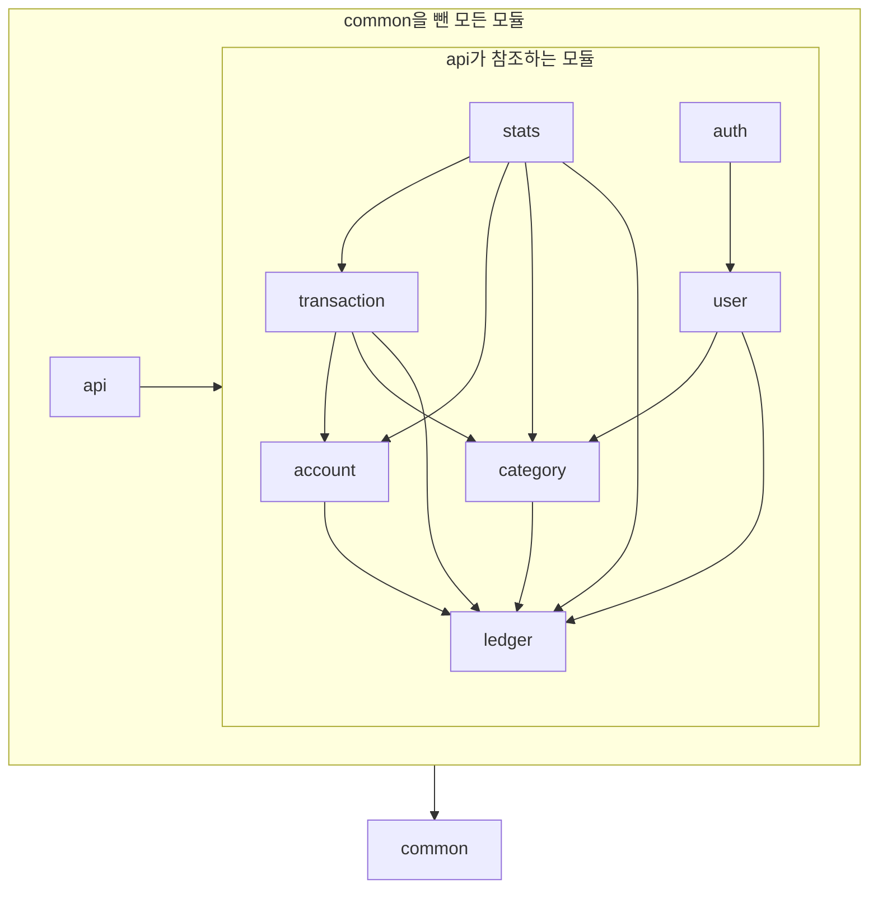

# ADR 004: 모듈 경계와 의존 규칙

- 상태: 제안됨 (2026-11-24)
- 결정한 사람: architect. ArchUnit을 쓰는 것(결정 7)은 owner가 2026-11-24에 정했다.

## 배경

`server/`는 `app.accountbook` 아래 패키지 7개로 되어 있다: account, category, common, ledger, stats, transaction, user.
컨트롤러는 아직 없고(확인) API 이슈 26개(2026-11-24 기준)가 대기 중이다.

지금의 의존 관계는 다음과 같다(main `baaa2a4`의 import와 테스트로 확인. `server/`는 `9a31116` 이후 바뀌지 않았다).

- 순환 의존이 2개 있다.
  - account ↔ transaction: `AccountService`가 `transaction.TransactionLineRepository`를, `TransactionService`가 `account.Account`, `AccountRepository`를 참조한다.
  - category ↔ transaction: `CategoryService`가 `transaction.TransactionLineRepository`를, `TransactionService`가 `category.Category`, `CategoryKind`, `CategoryRepository`, `CategoryService`를 참조한다.
- user는 ledger, category를 참조한다. 가입 때 개인 장부와 기본 카테고리를 만들기 때문이다.
- stats는 account, category, ledger, transaction을 참조한다.
- account, category, transaction은 ledger를 참조한다.
- 다른 모든 모듈이 common을 참조한다.
- 경계를 검사하는 테스트는 없다.

지금 정하는 이유는 컨트롤러가 붙기 전이 고칠 곳이 가장 적기 때문이다. 지금 순환을 푸는 데는 반나절쯤 든다(추정).
엉킨 채로 API 26개가 쌓이면 한 모듈을 고칠 때 다른 모듈 테스트까지 같이 깨져, 기능 하나를 만드는 비용이 계속 늘어난다(추정).

## 결정

### 1. 배포 단위는 하나다

배포 단위는 Spring Boot 모놀리스 하나다. 서비스 분리는 새 ADR 없이는 하지 않는다.

### 2. 모듈의 단위는 최상위 패키지다

모듈은 `app.accountbook` 바로 아래 패키지다. 이 문서의 "최상위 패키지"는 이것을 가리킨다.
모듈 안에서 공개용과 내부용 하위 패키지를 나누는 규칙은 지금 두지 않는다. 모듈이 커져 필요해지면 그때 정한다.

### 3. 허용하는 의존 방향

화살표는 "참조한다"는 뜻이다.

- 모든 모듈 → common. common은 다른 모듈을 참조하지 않는다.
- account, category → ledger
- transaction → account, category, ledger
- user → ledger, category
- auth → user
- stats → account, category, ledger, transaction (읽기 전용)
- api → account, auth, category, ledger, stats, transaction, user
- demo → account, category, ledger, transaction, user (local 프로파일 전용 데모 데이터, #349). 어떤 모듈도 demo를 참조하지 않는다.

위에 없는 방향은 금지한다. stats와 auth를 참조할 수 있는 것은 api뿐이다.
api와 auth는 아직 없는 패키지이고 첫 API 이슈(#12)에서 생긴다.
새 모듈을 추가하거나 방향을 더할 때는 이 ADR을 고친다. 새 번호의 ADR로 대체하거나 보완한다.

상자에 붙은 화살표는 상자 안의 모든 모듈에 해당한다.

### 4. 순환 의존은 0개다

최상위 패키지 사이 순환 의존은 0개다.

### 5. 지금 있는 순환 2개를 푸는 방향

account와 category가 transaction을 참조하지 않는 쪽으로 푼다. 실제 수정은 #70에서 한다.

계좌나 카테고리가 "거래에서 쓰이고 있는가"를 알아야 할 때는 account, category가 자기 패키지에 작은 인터페이스를 선언하고 transaction이 구현한다.
그러면 소스의 참조는 transaction → account, category 한 방향만 남는다.
이 인터페이스에는 지금 필요한 질문인 "쓰이고 있는지"만 넣는다. 거래 옮기기와 영향받는 거래 수 조회는 #3이 만들 때 같은 방식(account, category가 선언하고 transaction이 구현)으로 더한다.

### 6. 웹 계층은 api, 인증은 auth에 둔다

- 컨트롤러, 요청·응답 객체, 공통 오류 처리(ADR 002)는 `app.accountbook.api`에 둔다. api 안에서는 자원별 하위 패키지로 나눠도 된다.
- api는 모든 모듈을 참조할 수 있고, 어떤 모듈도 api를 참조하지 않는다.
- 여러 모듈의 값을 한 응답에 합치는 일은 api가 한다: 계좌 목록의 잔액(#13), 거래 목록의 월 합계(#15), 거래·변경 이력의 사람 표시 이름(#47, #59, #68). 도메인 모듈끼리는 이 때문에 서로를 참조하지 않는다.
- api는 트랜잭션을 열지 않는다. 트랜잭션은 각 모듈의 서비스가 연다. api가 여러 모듈의 값을 읽어 합칠 때 생기는 짧은 시점 차이는 받아들인다. 여러 모듈을 한 트랜잭션으로 바꿔야 하는 쓰기는 api가 아니라 그 동작의 주인인 모듈의 서비스가 트랜잭션을 연다(카테고리 삭제는 category, 비밀번호 바꾸기는 auth). 주인 모듈이 허용 방향의 위쪽 모듈을 불러야 하면 결정 5의 인터페이스로 부르고 같은 트랜잭션 안에서 처리한다(카테고리 삭제 때 거래 옮기기, #3).
- 도메인 모듈은 사람을 사용자 id로만 가리킨다. 표시 이름은 api가 user 모듈에서 찾아 붙인다. 그래서 transaction → user는 계속 금지다.
- 로그인, 토큰 발급과 검증, refresh token 저장과 회전(#12, #26, #28)은 `app.accountbook.auth`에 둔다. 가입(#29)과 사용자 정보는 user에 남는다.
- 비밀번호 바꾸기(#31)처럼 사용자 정보 변경과 refresh token 폐기를 한 번에 해야 하는 동작은 auth에 둔다. auth가 user를 불러 한 트랜잭션으로 처리한다(auth → user).
- 가입 직후 토큰 발급처럼 user와 auth를 이어서 부르는 흐름은 api가 차례로 부른다.
- 보안 필터 설정과 인증 실패(401)·권한 부족(403) 응답 작성은 api에 둔다. 응답 형식(ADR 002)을 아는 것은 api뿐이기 때문이다(api → auth). 이 일에서 auth는 토큰 발급과 검증만 제공하고 api를 참조하지 않는다.
- 요청·응답 객체는 JPA 엔터티와 분리하고, 엔터티를 응답으로 그대로 내보내지 않는다.
- 외부 연동용 객체(나중의 문자·엑셀 입력)와 API 응답 객체도 분리한다.
- 포트와 어댑터 같은 무거운 계층 구조를 모든 모듈에 강제하지 않는다.

### 7. 강제 방법은 ArchUnit 테스트다

검사는 두 가지다.

- 최상위 패키지 순환 0개
- 각 모듈은 결정 3의 허용 목록에 있는 모듈만 참조한다. common과 stats 규칙이 여기에 포함된다.

검사 대상은 main 코드만이다. 테스트 코드와 테스트 지원 코드(support)는 뺀다. `./gradlew test`에서 같이 돈다. 규칙은 실제로 어긴 사례가 나왔을 때만 늘린다.

## 검토한 대안

강제 방법:

| 대안 | 무엇을 막는가 | 드는 비용 | 판단 | 다시 볼 조건 |
|---|---|---|---|---|
| 문서로만 두기 | 막지 못한다. 지금까지 의존 규칙도 검사도 없었고 그 사이 순환 2개가 생겼다 | 0 | 채택하지 않음 | 정하지 않음 |
| ArchUnit 테스트 | 패키지 단위 규칙을 빌드에서 잡는다. 규칙을 어겨도 컴파일은 되고 테스트에서 잡힌다는 한계가 있다 | 테스트 의존성 1개와 테스트 파일 1개 | **채택** | 아래 "다시 검토할 조건" |
| Spring Modulith | 모듈의 공개 범위와 모듈 간 이벤트까지 다룬다 | 7개 패키지, 개발자 한 명과 봇이라는 지금 규모에는 규칙과 배울 것이 과하다. Spring Boot 4.2와 맞는 버전이 있는지는 미확인 | 채택하지 않음 | 모듈의 내부와 공개 부분을 나눠야 할 만큼 모듈이 커질 때 |
| Gradle 다중 모듈(물리적 분리) | 금지된 참조가 컴파일에서 막혀 가장 강하다 | 빌드 설정, 테스트 지원 코드(Fixtures, Testcontainers 설정) 공유, 모듈을 하나 더할 때마다 드는 설정 비용 | 채택하지 않음 | ArchUnit 규칙이 자주 깨지거나, 빌드 시간을 모듈 단위로 줄여야 할 때 |

웹 계층의 위치(채택: 결정 6의 api 모듈):

| 대안 | 좋은 점 | 대가 | 판단 |
|---|---|---|---|
| 컨트롤러를 각 모듈에 두기 | 기능 하나가 한 패키지에 모인다 | 응답을 합쳐야 하는 API(#13, #15, 사람 이름)마다 컨트롤러 위치가 정해지지 않거나 stats, user로 가는 금지 방향이 필요해진다 | 채택하지 않음 |
| 화면이 따로 요청해서 합치기(잔액, 월 합계를 별도 API로만 제공) | 모듈은 깨끗하다 | 이미 정한 화면 요구(#13, #15)를 바꿔야 하고 요청 수가 는다 | 채택하지 않음 |

## 결과

**좋아지는 것**

- 한 모듈을 고칠 때 영향받는 범위가 그림대로 한정된다.
- 봇이 올린 PR이 경계를 어기면 빌드가 알려 준다.

**대가**

- 테스트 의존성 1개가 늘고 인터페이스 2개쯤이 더해진다.
- 기능 하나를 만들 때 api와 도메인 모듈 두 곳을 고친다.
- 방향을 바꾸려면 ADR을 고쳐야 한다.

**받아들인 위험**

- 규칙을 어겨도 컴파일은 된다. 테스트를 돌려야 드러난다.
- JPQL 문자열로 다른 모듈의 엔터티를 가리키는 참조는 ArchUnit이 보지 못한다(추정). stats의 쿼리가 여기에 해당하며 stats는 허용 방향 안이라 지금은 문제가 없다.

**다시 검토할 조건**

- 모듈이 12개를 넘을 때
- 허용 방향 예외 요청이 반복될 때
- 서비스 분리를 검토하게 될 때
