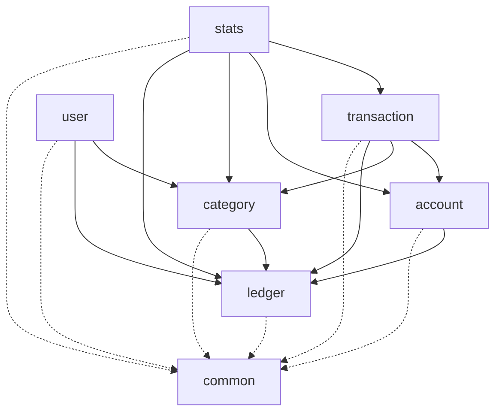

# ADR 004: 모듈 경계와 의존 규칙

- 상태: 제안됨 (2026-11-24)
- 결정한 사람: architect. 강제 방법(결정 7)은 owner가 2026-11-24에 정했다.

## 배경

`server/`는 `app.accountbook` 아래 패키지 7개로 되어 있다: account, category, common, ledger, stats, transaction, user.
컨트롤러는 아직 없고(확인) API 이슈 30여 개가 대기 중이다(이슈 #69 기준).

지금의 의존 관계는 다음과 같다(main `baaa2a4`의 import로 확인. `server/`는 `9a31116` 이후 바뀌지 않았다).

- 순환 의존이 2개 있다.
  - account ↔ transaction: `AccountService`가 `transaction.TransactionLineRepository`를, `TransactionService`가 `account.Account`, `AccountRepository`를 참조한다.
  - category ↔ transaction: `CategoryService`가 `transaction.TransactionLineRepository`를, `TransactionService`가 `category.Category`, `CategoryKind`, `CategoryRepository`, `CategoryService`를 참조한다.
- user는 ledger, category를 참조한다. 가입 때 개인 장부와 기본 카테고리를 만들기 때문이다.
- stats는 account, category, ledger, transaction을 참조한다.
- account, category, transaction은 ledger를 참조한다.
- 다른 모든 모듈이 common을 참조한다.

경계를 검사하는 테스트는 없다(확인).

지금 정하는 이유는 컨트롤러가 붙기 전이 고칠 곳이 가장 적기 때문이다.
지금 순환을 푸는 데는 반나절쯤 든다(추정).
엉킨 채로 API 30여 개가 쌓이면 한 모듈을 고칠 때 다른 모듈 테스트까지 같이 깨져, 기능 하나를 만드는 비용이 계속 늘어난다(추정).

## 결정

### 1. 배포 단위는 하나다

배포 단위는 Spring Boot 모놀리스 하나다. 서비스 분리는 새 ADR 없이는 하지 않는다.

### 2. 모듈의 단위는 최상위 패키지다

모듈은 `app.accountbook` 바로 아래 패키지다. 이 문서의 "최상위 패키지"는 이것을 가리킨다.
하위 패키지(api/internal 등)를 나누는 규칙은 지금 두지 않는다. 모듈이 커져 필요해지면 그때 정한다.

### 3. 허용하는 의존 방향

화살표는 "참조한다"는 뜻이다.

- 모든 모듈 → common. common은 다른 모듈을 참조하지 않는다.
- account, category → ledger
- transaction → account, category, ledger
- user → ledger, category
- stats → account, category, ledger, transaction. stats는 읽기 전용이고 어떤 모듈도 stats를 참조하지 않는다.

위에 없는 방향은 금지한다.
새 모듈을 추가하거나 방향을 더할 때는 이 ADR을 고친다. 새 번호의 ADR로 대체하거나 보완한다.

점선은 common으로 가는 참조를 구분해 그린 것이고 뜻은 실선과 같다.

### 4. 순환 의존은 0개다

최상위 패키지 사이 순환 의존은 0개다.

### 5. 지금 있는 순환 2개를 푸는 방향

account와 category가 transaction을 참조하지 않는 쪽으로 푼다.

계좌나 카테고리가 "거래에서 쓰이고 있는가"를 알아야 할 때는 account, category가 자기 패키지에 작은 인터페이스를 선언하고 transaction이 구현한다.
그러면 소스의 참조는 transaction → account, category 한 방향만 남는다.
이 인터페이스는 지금 필요한 질문(쓰이고 있는지, 카테고리 삭제 때 거래 옮기기)만 담는다.

실제 수정은 #70에서 한다.

### 6. API 계층 규칙

- 컨트롤러는 자기 모듈 패키지에 둔다.
- 요청·응답 객체는 JPA 엔터티와 분리하고, 엔터티를 응답으로 그대로 내보내지 않는다.
- 외부 연동용 객체(나중의 문자·엑셀 입력)와 API 응답 객체도 분리한다.
- 포트와 어댑터 같은 무거운 계층 구조를 모든 모듈에 강제하지 않는다.

### 7. 강제 방법은 ArchUnit 테스트다

owner가 2026-11-24에 정했다. 검사 항목은 세 가지로 시작한다.

- 최상위 패키지 순환 0개
- common은 다른 모듈을 참조하지 않는다
- stats를 참조하는 모듈이 없다

`./gradlew test`에서 같이 돈다. 규칙은 실제로 어긴 사례가 나왔을 때만 늘린다.

## 검토한 대안

| 대안 | 무엇을 막는가 | 드는 비용 | 판단 | 다시 볼 조건 |
|---|---|---|---|---|
| 문서로만 두기 | 막지 못한다. 지금 순환 2개가 생긴 것이 이 방식의 결과다 | 0 | 채택하지 않음 | 정하지 않음 |
| ArchUnit 테스트 | 패키지 단위 규칙을 빌드에서 잡는다. 규칙을 어겨도 컴파일은 되고 테스트에서 잡힌다는 한계가 있다 | 테스트 의존성 1개와 테스트 파일 1개 | **채택** | 아래 "다시 검토할 조건" |
| Spring Modulith | 모듈의 공개 범위와 모듈 간 이벤트까지 다룬다 | 7개 패키지, 개발자 한 명과 봇이라는 지금 규모에는 규칙과 배울 것이 과하다. Spring Boot 4.2와 맞는 버전이 있는지는 미확인 | 채택하지 않음 | 모듈의 내부와 공개 부분을 나눠야 할 만큼 모듈이 커질 때 |
| Gradle 다중 모듈(물리적 분리) | 금지된 참조가 컴파일에서 막혀 가장 강하다 | 빌드 설정, 테스트 지원 코드(Fixtures, Testcontainers 설정) 공유, 모듈을 하나 더할 때마다 드는 설정 비용 | 채택하지 않음 | ArchUnit 규칙이 자주 깨지거나, 빌드 시간을 모듈 단위로 줄여야 할 때 |

## 결과

### 좋아지는 것

- 한 모듈을 고칠 때 영향받는 범위가 그림대로 한정된다.
- 봇이 올린 PR이 경계를 어기면 빌드가 알려 준다.

### 대가

- 테스트 의존성 1개가 늘어난다.
- 인터페이스 2개쯤이 더해진다.
- 방향을 바꾸려면 ADR을 고쳐야 한다.

### 받아들인 위험

- 규칙을 어겨도 컴파일은 된다. 테스트를 돌려야 드러난다.
- 결정 7의 검사 세 가지는 결정 3의 방향 전부를 검사하지 않는다. 순환을 만들지 않는 금지 방향(예: account → category)은 테스트에서 잡히지 않는다.

### 다시 검토할 조건

- 모듈이 12개를 넘을 때
- 허용 방향 예외 요청이 반복될 때
- 서비스 분리를 검토하게 될 때
