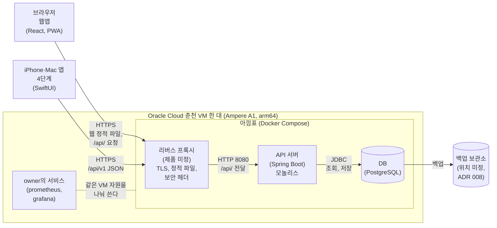

# ADR 005: 배포 구성(같은 출처, VM 한 대)

- 상태: 제안됨 (2026-11-24)
- 결정한 사람: owner(웹과 API를 같은 출처로 둔다, 2026-11-24), architect(나머지 구성과 조건)

## 배경

- 클라이언트는 웹앱(React, PWA)이다. 4단계에는 iPhone·Mac 네이티브 앱이 같은 API를 쓴다. API는 `/api/v1` 아래의 JSON이다(설계 문서 5장).
- 로그인은 JWT를 쓴다. access token은 15분 동안 유효하고 Authorization 헤더로 보낸다. refresh token은 HttpOnly 쿠키로 전달한다(owner 결정 2026-11-23).
- 쿠키의 범위와 CSRF 방어 방식은 웹과 API가 같은 출처인지에 따라 달라진다. ADR 001(인증, #22)의 쿠키와 CSRF 항목은 이 결정을 전제로 한다.
- 서버는 Oracle Cloud 춘천 리전의 기존 VM이다. Ampere A1, 4 OCPU, 메모리 24GB, arm64다. owner가 쓰는 prometheus와 grafana가 같은 VM에서 돈다(owner 확인 2026-11-24).
- 1단계는 owner 혼자 쓴다. 배포는 owner 승인 뒤에만 한다.
- devops와 security가 같은 출처 구성에 찬성했다(2026-11-23). owner가 같은 출처로 결정했다(2026-11-24).
- 확인(main `baaa2a4`): 서버와 웹 코드에 CORS 설정이 없다. 루트 `compose.yaml`은 로컬 개발용 PostgreSQL만 띄운다. 배포용 Compose 파일은 아직 없다.
- 미확인: 이 문서를 쓰면서 VM에 접속하지 않았다. VM에 열린 포트와 남은 자원은 보지 못했다.

## 결정

1. **출처.** 웹과 API는 같은 출처다. 한 도메인(이름은 미정)에서 리버스 프록시가 TLS를 끝내고, 웹 정적 파일을 내고, `/api/`로 시작하는 요청을 Spring Boot로 넘긴다.
2. **구성.** VM 한 대에 Docker Compose로 올린다. 컨테이너는 리버스 프록시, API 서버(Spring Boot 모놀리스 하나), PostgreSQL 세 가지다. 리버스 프록시 제품은 devops가 정한다(devops 제안: Caddy, 인증서 자동 갱신).
3. **포트.** 밖에 여는 포트는 프록시의 80과 443뿐이다. API 서버의 8080과 DB 포트는 호스트 밖에 열지 않는다. `/actuator`는 밖에 내지 않고, 상태 확인은 프록시가 정한 주소 하나로만 낸다.
4. **이미지.** 이미지는 CI에서 arm64로 한 번 빌드해 커밋 SHA 태그로 올린다. 서버에서는 빌드하지 않는다. 되돌리기는 이전 태그로 다시 띄운다.
5. **CORS.** CORS 설정을 두지 않는다. 다른 출처의 브라우저 요청은 받지 않는다.
6. **같은 출처에 따르는 조건.** security가 낸 조건이다. 세부 값은 ADR 001이 확정한다.
   - refresh 쿠키의 속성은 `HttpOnly; Secure; SameSite=Strict; Path=/api/v1/auth`다. Domain 속성은 두지 않는다. 이름에 `__Secure-` 접두어를 붙인다.
   - 쿠키로 인증하는 요청은 갱신과 로그아웃뿐이다. 이 둘은 Origin 헤더 확인과 전용 요청 헤더 요구로 CSRF를 막고, 테스트로 고정한다. 나머지 API는 Authorization 헤더로만 인증한다.
   - SameSite는 등록 도메인 단위로 판정된다. 아낌표와 같은 등록 도메인의 서브도메인에 다른 앱이나 사용자 콘텐츠를 두지 않는다. 같은 VM의 grafana를 밖에 낼 때는 다른 등록 도메인을 쓰거나 밖에 내지 않는다.
   - `X-Forwarded-*` 헤더는 프록시가 보낸 것만 믿는다. IP 기준 제한은 프록시가 넘긴 주소로 센다.
   - HSTS와 보안 헤더(CSP 포함)는 프록시 한 곳에서 붙인다. 로그인 없이 보는 열람 링크 화면(2단계)을 내기 전에 CSP가 적용돼 있어야 한다.
   - 초대, 열람 링크, 문자 전송 주소처럼 토큰이 든 주소와 쿼리 문자열은 접근 로그에 남기지 않는다.
7. **요청 id.** 프록시가 `X-Request-Id`를 만든다. 서버는 로그와 응답 헤더, 오류 응답 본문에 같은 값을 넣는다. 형식은 ADR 002(#24)가 정한다.
8. **메모리 상한.** VM을 다른 서비스와 같이 쓰므로 아낌표 컨테이너에는 메모리 상한을 둔다. 값은 devops가 정한다.
9. **구성 그림.** 아래와 같다.

## 검토한 대안

| 대안 | 내용 | 좋은 점 | 대가 | 판단 |
|---|---|---|---|---|
| 출처를 나눈다 | 예: 웹은 app, API는 api 서브도메인에 두거나 다른 호스팅에 둔다 | 웹을 CDN에 올리기 쉽다 | CORS 설정이 필요하다. 쿠키를 다른 출처로 보내려면 속성(SameSite)을 완화해야 한다. CSRF 방어 범위가 넓어진다 | 채택하지 않음. 지금 얻는 것이 없다 |
| Spring Boot가 TLS와 정적 파일을 직접 맡는다 | 프록시를 추가하지 않는다 | 컨테이너가 하나 줄고 새 기술이 없다 | 인증서 발급과 갱신을 직접 다뤄야 한다. 보안 헤더와 접근 로그 처리를 앱 코드에 넣어야 한다. 웹만 고쳐도 서버를 다시 배포해야 한다 | 채택하지 않음 |
| 관리형 플랫폼이나 여러 대 구성 | VM 한 대 대신 관리형 플랫폼이나 서버 여러 대에 올린다 | 지금은 없다. 1단계 사용자가 한 명이고 이미 VM이 있다 | 비용과 복잡도가 는다 | 채택하지 않음 |

## 결과

### 좋아지는 것

- 브라우저에서 CORS와 교차 출처 쿠키 문제가 없다.
- 인증 쿠키의 범위가 좁다.
- 네이티브 앱은 같은 도메인의 같은 API를 쓴다.

### 대가

- 프록시 설정 하나를 운영한다.
- 웹과 API의 주소 규칙(`/api/` 접두)을 바꾸기 어렵다.

### 받아들인 위험

- VM 한 대라 단일 장애 지점이다. 가용성 목표는 1단계에는 두지 않고 출시 때 99.5%로 본다(devops 제안, owner 확정 전).
- 무료 등급의 유휴 인스턴스는 회수될 수 있다(devops가 Oracle 문서에서 확인). 이 VM이 그 대상인지는 미확인이다.
- 다른 서비스와 자원을 나눠 쓴다.
- 복구는 백업에 달려 있다(ADR 008, #74).

### 되돌리기

- 호스팅 위치는 DB 덤프를 옮기면 바꿀 수 있다.
- 출처를 나누는 쪽으로 바꾸려면 쿠키와 CSRF 설계(ADR 001)를 다시 해야 한다.

### 미정

- 도메인 이름
- 프록시 제품(devops)
- 컨테이너 메모리 상한(devops)
- 백업 보관소 위치(ADR 008)

### 다시 검토할 조건

- 공개 출시로 가용성 목표가 99.5%를 넘어야 할 때
- 웹 정적 파일을 CDN에 올려야 할 만큼 사용자가 늘 때
