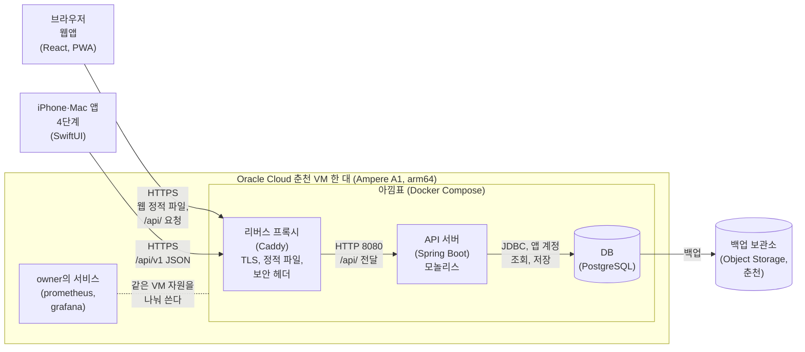

# ADR 005: 배포 구성(같은 출처, VM 한 대)

- 상태: 제안됨 (2026-11-24)
- 결정한 사람: owner(웹과 API를 같은 출처로 둔다, 2026-11-24), architect(나머지 구성과 조건)

## 배경

- 클라이언트는 웹앱(React, PWA)이다. 4단계에는 iPhone·Mac 네이티브 앱이 같은 API를 쓴다. API는 `/api/v1` 아래의 JSON이다(설계 문서 5장).
- 로그인은 JWT를 쓴다. access token은 15분 동안 유효하고 Authorization 헤더로 보낸다. refresh token은 HttpOnly 쿠키로 전달한다(owner 결정 2026-11-23).
- 쿠키의 범위와 CSRF 방어 방식은 웹과 API가 같은 출처인지에 따라 달라진다. ADR 001(인증, #22)의 쿠키와 CSRF 항목은 이 결정을 전제로 한다.
- 서버는 Oracle Cloud 춘천 리전의 기존 VM이다. Ampere A1, 4 OCPU, 메모리 24GB, arm64다. owner가 쓰는 prometheus와 grafana가 같은 VM에서 돈다(owner 확인 2026-11-24).
- 1단계는 owner 혼자 쓴다. 배포는 owner 승인 뒤에만 한다.
- devops와 security가 같은 출처 구성에 찬성했다(2026-11-23). owner가 같은 출처로 결정했다(2026-11-24).
- 확인(main `baaa2a4`): 서버와 웹 코드에 CORS 설정이 없다. 루트 `compose.yaml`은 로컬 개발용 PostgreSQL만 띄운다. 배포용 Compose 파일은 아직 없다.
- 미확인: 이 문서를 쓰면서 VM에 접속하지 않았다. VM에 열린 포트와 남은 자원은 보지 못했다.
- VM의 80과 443을 기존 서비스가 쓰고 있는지는 미확인이다. 쓰고 있으면 프록시 구성이 달라질 수 있다.

## 결정

1. **출처.** 웹과 API는 같은 출처다. 한 도메인(이름은 미정)에서 리버스 프록시가 TLS를 끝내고, 웹 정적 파일을 내고, `/api/`로 시작하는 요청을 Spring Boot로 넘긴다.
2. **구성.** VM 한 대에 Docker Compose로 올린다. 컨테이너는 리버스 프록시, API 서버(Spring Boot 모놀리스 하나), PostgreSQL 세 가지다. 리버스 프록시 제품은 devops가 정한다. devops 안은 Caddy다(#51, #52. 인증서 자동 갱신).
3. **포트.** 아낌표 컨테이너가 밖에 여는 포트는 프록시의 80과 443뿐이다. API 서버의 8080과 DB 포트는 호스트 밖에 열지 않는다. SSH와 기존 prometheus·grafana의 포트는 이 ADR의 범위 밖이다. `/actuator`는 밖에 내지 않는다. 상태 확인은 내부에서만 한다(#52).
4. **이미지.** 이미지는 CI에서 arm64로 한 번 빌드해 커밋 SHA 태그로 ghcr.io에 올린다(#51). 서버에서는 빌드하지 않는다. 배포와 되돌리기는 태그가 아니라 이미지 digest로 지정한다(#52). 되돌리기는 이미지만 이전 것으로 돌린다. 이미 적용된 Flyway 마이그레이션은 남으므로, 새 스키마는 바로 전 버전의 서버와 맞아야 한다(추가 먼저, 삭제는 다음 릴리스). 백업에서 복구하는 것은 데이터가 망가졌을 때의 마지막 수단이고 자동으로 하지 않는다.
   - owner가 운영 DB에 실제 지출을 넣기 시작하는 날부터 마이그레이션은 앱 기동과 분리된 배포의 별도 단계로 돌리고, DB 계정을 소유자 계정(마이그레이션용)과 앱 계정(앱 실행용, DML만)으로 나눈다(owner 결정 2026-11-24, #52).
5. **CORS.** CORS 허용 설정을 두지 않는다. 다른 출처의 스크립트는 응답을 읽지 못한다. 요청 자체는 서버에 닿을 수 있으므로, 로그인한 사용자의 상태를 바꾸는 API는 Authorization 헤더가 있어야 하고, 쿠키로 인증하는 두 요청은 서버가 Origin을 확인해 거부한다. 로그인과 가입처럼 인증 전에 받는 요청을 다른 출처에서 보냈을 때의 처리는 ADR 001이 정한다. 주소의 토큰으로 인증하는 요청은 결정 6의 예외를 따른다.
6. **같은 출처에 따르는 조건.** security가 낸 조건이다. 세부 값은 ADR 001이 확정한다.
   - refresh 쿠키의 속성은 `HttpOnly; Secure; SameSite=Strict; Path=/api/v1/auth`다. Domain 속성은 두지 않는다. 이름에 `__Secure-` 접두어를 붙인다.
   - 쿠키로 인증하는 요청은 갱신과 로그아웃뿐이다. 이 둘은 Origin 헤더 확인과 전용 요청 헤더 요구로 CSRF를 막고, 테스트로 고정한다.
   - 로그인한 사용자의 API는 Authorization 헤더로만 인증한다. 예외는 주소에 든 토큰으로 인증하는 열람 링크(2단계, P-311)와 문자 전송 주소(3단계, P-508)다. 이 둘은 쿠키를 쓰지 않으므로 CSRF 대상이 아니다.
   - 네이티브 앱(4단계)이 refresh token을 어떻게 보관하고 보내는지, Origin 헤더가 없는 요청을 어떻게 다루는지는 4단계 전에 ADR 001을 보완해 정한다.
   - SameSite는 등록 도메인 단위로 판정된다. 아낌표와 같은 등록 도메인의 서브도메인에 다른 앱이나 사용자 콘텐츠를 두지 않는다. 같은 VM의 grafana를 밖에 낼 때는 다른 등록 도메인을 쓰거나 밖에 내지 않는다.
   - 도메인을 정하기 전의 임시 주소도 같은 조건을 따른다. Public Suffix List에 올라 있어 우리만의 등록 도메인이 되는 것만 쓴다(예: duckdns.org는 올라 있고 sslip.io는 없다. 2026-11-23 판에서 확인).
   - IP 주소로 직접 여는 경우는 등록 도메인이 없고 그 주소가 곧 사이트이므로, 같은 IP에서 다른 앱을 같은 포트로 내지 않는 한 이 조건을 만족한다.
   - `X-Forwarded-*` 헤더는 프록시가 보낸 것만 믿는다. IP 기준 제한은 프록시가 넘긴 주소로 센다.
   - HSTS와 보안 헤더(CSP 포함)는 프록시 한 곳에서 붙인다. 로그인 없이 보는 열람 링크 화면(2단계)을 내기 전에 CSP가 적용돼 있어야 한다.
   - 토큰이 든 주소(쿼리 문자열, 그리고 `/invite/...`, `/view/...`, 문자 전송 주소처럼 경로에 토큰이 든 것)는 접근 로그에 토큰이 남지 않게 한다. 경로의 토큰을 가리는 설정은 그 기능이 들어가는 단계 전에 넣는다: 초대와 열람 링크는 2단계, 문자 전송 주소는 3단계, 이메일 인증과 비밀번호 재설정 링크는 출시 단계(P-103, P-107).
   - 토큰이 든 주소로 여는 화면과 응답에는 `Referrer-Policy: no-referrer`와 `Cache-Control: no-store`를 붙인다.
7. **요청 id.** 프록시가 `X-Request-Id`를 만든다. 서버는 로그와 응답 헤더, 오류 응답 본문에 같은 값을 넣는다. 형식은 ADR 002(#24)가 정한다.
8. **메모리 상한.** VM을 다른 서비스와 같이 쓰므로 아낌표 컨테이너에는 메모리 상한을 둔다. 값은 devops가 정한다(초안은 #52).
9. **구성 그림.** 아래와 같다.

## 검토한 대안

| 대안 | 내용 | 좋은 점 | 대가 | 판단 |
|---|---|---|---|---|
| 출처를 나눈다 | 예: 웹은 app, API는 api 서브도메인에 두거나 다른 호스팅에 둔다 | 웹을 CDN에 올리기 쉽다 | 같은 등록 도메인의 서브도메인으로 나누면 CORS 설정과 사전 요청이 든다. 다른 등록 도메인으로 나누면 여기에 쿠키 SameSite 완화와 넓어지는 CSRF 방어 범위가 더해진다 | 채택하지 않음. 지금 얻는 것이 없다 |
| Spring Boot가 TLS와 정적 파일을 직접 맡는다 | 프록시를 추가하지 않는다 | 컨테이너가 하나 줄고 새 기술이 없다 | 인증서 발급과 갱신을 직접 다뤄야 한다. 보안 헤더와 접근 로그 처리를 앱 코드에 넣어야 한다. 웹만 고쳐도 서버를 다시 배포해야 한다 | 채택하지 않음 |
| 관리형 플랫폼이나 여러 대 구성 | VM 한 대 대신 관리형 플랫폼이나 서버 여러 대에 올린다 | 지금은 없다. 1단계 사용자가 한 명이고 이미 VM이 있다 | 비용과 복잡도가 는다 | 채택하지 않음 |

## 결과

### 좋아지는 것

- 브라우저에서 CORS와 교차 출처 쿠키 문제가 없다.
- 인증 쿠키의 범위가 좁다.
- 네이티브 앱은 같은 도메인의 같은 API를 쓴다.

### 대가

- 프록시 설정 하나를 운영한다.
- 웹과 API의 주소 규칙(`/api/` 접두)을 바꾸기 어렵다.

### 받아들인 위험

- VM 한 대라 단일 장애 지점이다. 가용성 목표는 1단계에는 두지 않고 출시 때 99.5%로 본다(devops 제안, owner 확정 전).
- 무료 등급의 유휴 인스턴스는 회수될 수 있다(devops가 Oracle 문서에서 확인). 이 VM이 그 대상인지는 미확인이다.
- 다른 서비스와 자원을 나눠 쓴다.
- 복구는 백업에 달려 있다(ADR 008, #74).

### 되돌리기

- 호스팅 위치는 DB 덤프를 옮기면 바꿀 수 있다.
- 출처를 나누는 쪽으로 바꾸려면 쿠키와 CSRF 설계(ADR 001)를 다시 해야 한다.

### 미정

- 도메인 이름

아래는 이슈에 값이 있다. 이슈의 출처 표기는 "devops의 배포·백업 안. owner 확정(2026-11-24)"이다.

- 프록시 제품: Caddy(#51, #52)
- 컨테이너 메모리 상한: 초안 서버 1GB, DB 1GB(#52)
- 백업 보관소: Oracle Cloud Object Storage 춘천(#53)

### 다시 검토할 조건

- 공개 출시로 가용성 목표가 99.5%를 넘어야 할 때
- 웹 정적 파일을 CDN에 올려야 할 만큼 사용자가 늘 때
