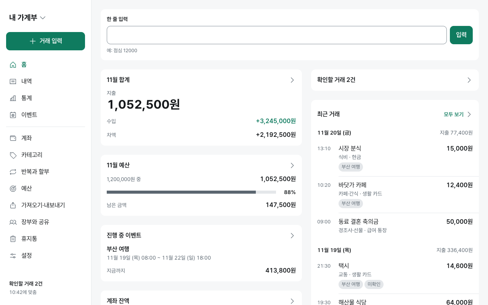
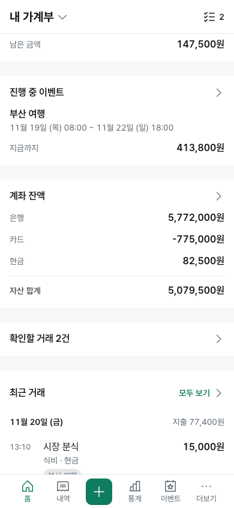
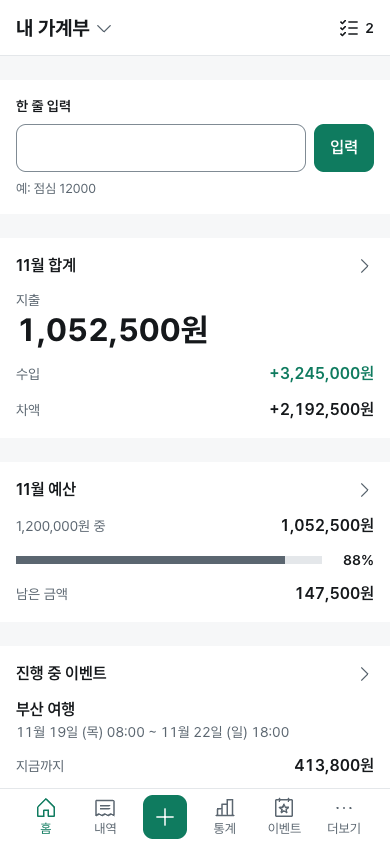

# 시안으로 고른 배치 결정

- 작성일: 2026-11-24
- 상태: owner가 시안 이미지를 보고 고른 배치 결정을 수치로 적는다.
- 시안은 설계서 토큰과 owner가 추가한 2색으로 만들었고 데이터는 목업 홈과 같다.
- 그림은 참고이고 기준은 이 문서의 수치다. 시안을 바꾸려면 이 문서의 수치를 고치고 그림을 다시 찍는다.
- "시안에서 쓴 값"이라고 적힌 수치는 설계서에 없어 designer가 시안에 넣었고 owner가 시안으로 고른 값이다.
- 설계서와 다른 곳은 4절 확인 필요에 모았다. 이 폴더는 `docs/planning`을 고치지 않는다.

## 1. 넓은 화면(1024px 이상)의 홈 (owner 결정 10)

그림: [drafts/2026-11-24-home-wide-1280x800.png](drafts/2026-11-24-home-wide-1280x800.png)

- 틀: 왼쪽 사이드바 폭 240px(설계서 2.5), 오른쪽 내용 영역. 내용 영역 안쪽 여백 24px(설계서 2.4).
- 내용 영역: 맨 위에 한 줄 입력을 전체 폭으로 둔다. 그 아래를 두 칸으로 나눈다(와이어프레임 01 C-01 넓은 화면). 한 줄 입력과 두 칸 사이, 두 칸 사이 간격은 24px이다.
- 왼쪽 칸(나머지 폭, 최소 360px): 이번 달 합계, 예산, 진행 중 이벤트, 계좌 잔액 순서. 오른쪽 칸(폭 440px, 설계서 2.5의 오른쪽 칸 폭): 확인할 거래, 최근 거래 순서.
- 묶음은 카드다: `color-surface` 바탕, 모서리 12px, 테두리와 그림자 없음(배경색과의 차이로 나눈다, 설계서 2.4). 카드 사이 24px. 카드 안쪽 여백 16px(시안에서 쓴 값). 카드 안 요소 사이 12px.
- 두 칸은 따로 스크롤하지 않고 내용 영역 전체가 함께 스크롤된다(시안에서 쓴 값).
- 사이드바(시안에서 쓴 값. 구성과 순서는 와이어프레임 00-common 3.2): 안쪽 여백 위아래 24px, 좌우 16px. 위에서부터 장부 전환기(`text-title`), "거래 입력" 주 버튼(전체 폭, 높이 48px, Plus 아이콘 20px), 메뉴, 맨 아래에 확인할 거래 건수(`text-label`)와 마지막으로 맞춘 시각(`text-caption`, `color-text-secondary`). 요소 사이 16px.
- 사이드바 메뉴 줄(시안에서 쓴 값): 높이 44px, 아이콘 20px(`color-text-secondary`)과 이름(`text-body`), 사이 12px. 지금 화면의 줄은 아이콘과 글자를 `color-accent`로, 글자 굵기를 600으로 한다. 바탕은 칠하지 않는다. 묶음 사이에는 1px `color-border` 선.
- 버린 안: 한 칸을 가운데 720px로 두는 배치. 이유: 최근 거래가 첫 화면에서 보이지 않는다.
- 이 결정으로 [components.md](components.md) 10절 C-8(사이드바의 지금 화면 항목 모양)은 "결정됨(owner 2026-11-24, 시안으로 고름)"이다.

## 2. 빠른 입력 버튼은 하단 탭의 가운데 칸 (owner 결정 11)

그림: [drafts/2026-11-24-quick-add-tab-390x844.png](drafts/2026-11-24-quick-add-tab-390x844.png)

- 휴대폰 배치(1024px 미만)에서 빠른 입력 버튼은 떠 있지 않고 하단 탭의 한 칸이다.
- 모양: 44x44px, `color-accent` 바탕, `color-on-accent` Plus 아이콘 24px, 모서리 10px, 그림자 없음, 글자 없음. 접근성 이름 "거래 입력". 칸 안에서 가운데.
- 칸 순서: 홈, 내역, 거래 입력, 통계, 이벤트, 더보기(6칸, 같은 폭). 이벤트 탭이 없는 1단계는 홈, 내역, 거래 입력, 통계, 더보기(5칸).
- 보기 전용 구성원에게는 거래 입력 칸이 없다(권한 없는 버튼은 숨긴다).
- 떠 있는 버튼이 없어지므로 내용 아래 여백은 버튼 몫을 빼고 24px이다. 토스트는 하단 탭 위 16px, 좌우 여백 16px의 폭이다.
- 넓은 화면은 그대로 사이드바의 "거래 입력" 버튼이다.
- 버린 안: (1) 하단 탭 위에 전체 폭 "거래 입력" 줄을 두는 안. 이유: 모든 화면에서 내용 높이가 65px 줄어든다. (2) 떠 있는 버튼을 그대로 두는 안. 이유: 스크롤 중 목록의 금액을 가린다(390x844에서 `npx impeccable detect`가 금액 83% 가림으로 잡음).
- 확인 필요: 4절 L-1, L-2.

## 3. 휴대폰 배치의 묶음 사이 간격 (owner 결정 12)

그림: [drafts/2026-11-24-section-gap-24-390x844.png](drafts/2026-11-24-section-gap-24-390x844.png)

- 홈처럼 묶음이 위아래로 쌓이는 화면에서 묶음 사이는 24px이다(설계서 2.4). 첫 묶음 위도 24px.
- 묶음은 좌우 끝까지 닿는 `color-surface` 면이고 모서리는 0, 안쪽 여백은 16px, 묶음 안 요소 사이는 12px이다.
- 버린 안: 8px(목업의 값). 이유: 설계서 값이 아니고 묶음의 경계가 덜 분명하다.

## 4. 확인 필요

owner가 답하기 전에는 구현에서 임의로 정하지 않는다. L-1과 L-2는 designer가 적었고, L-3부터는 이 문서를 옮겨 쓰며 설계서, 와이어프레임, 시안 CSS와 대조하다 찾은 것이다(값은 정하지 않았다).

| # | 내용 | 관련 |
|---|------|------|
| L-1 | 설계서는 빠른 입력 버튼을 M 그룹(설정), N 그룹 화면에서 숨긴다(와이어프레임 00-common 3.1). 탭의 한 칸이 되면 화면에 따라 탭 칸 수가 바뀌어 탭 위치가 움직인다. designer 제안: 하단 탭이 보이는 모든 화면에서 거래 입력 칸을 보이고 보기 전용에게만 숨긴다(넓은 화면 사이드바 버튼의 규칙과 같게). owner 결정 전에는 구현에서 임의로 정하지 않는다 | 결정 11 |
| L-2 | 결정 11에 맞춰 고쳐야 하는 기준 문서: 와이어프레임 00-common 3.1의 (4)와 (5), 화면설계서 00-common의 2.4(빠른 입력 버튼 그림자와 56x56px), 5.7(토스트 폭), 6.1(내용 아래 여백), 6.2(B-01), 6.4(B-03), 기능정의서 F-102. 이 폴더는 `docs/planning`을 고치지 않는다 | 결정 11 |
| L-3 | L-2 말고도 떠 있는 빠른 입력 버튼을 적은 곳이 더 있다(grep으로 찾음): 화면설계서 00-common 2.5의 두 줄(768px 미만, 768px 이상 1024px 미만), 2.6의 층 순서, 6.1의 표 (4), 6.6의 B-05 공통 틀 줄, 9절 판단 47과 54, IA 2절 B-03, 화면설계서 01과 와이어프레임 01의 "공통 틀" 줄들(M 그룹, N 그룹, A-08, A-09에 "빠른 입력 버튼은 없다") | 결정 11 |
| L-4 | 결정 10에 맞춰 고쳐야 하는 기준 문서: 화면설계서 01 C-01의 넓은 화면(왼쪽이 "내용 폭의 40%"인데 결정은 오른쪽 440px, 왼쪽 나머지), C-01의 "구역은 상자로 감싸지 않고 구분선과 여백으로 나눈다"와 와이어프레임 00-common 4절 규칙 7(상자는 꼭 필요한 곳에만), 00-common 6.2의 5-6(더보기 항목은 "아이콘 없이 이름만"), 6.3(장부 전환기 이름은 `text-body-strong`), 6.4의 4-1(사이드바 거래 입력 버튼 높이 44px), 6.7의 3-1(사이드바 글자는 "미확인 {N}건", `text-body`). 결정은 각각 카드, 아이콘과 이름, `text-title`, 48px, "확인할 거래" 건수(`text-label`)다 | 결정 10 |
| L-5 | 폭 1024px 이상 1112px 미만에서는 왼쪽 칸 최소 360px을 지킬 수 없다. 사이드바 240 + 여백 24 + 왼쪽 360 + 간격 24 + 오른쪽 440 + 여백 24 = 1112px이고, 1024px에서 왼쪽 칸은 272px이 된다. 여백을 빼도 설계서 2.5의 수치(360 + 440 = 800px)가 1024px의 내용 영역 784px보다 크다. 이 구간의 배치가 정해져 있지 않다 | 결정 10, 설계서 2.5 |
| L-6 | 시안 그림이 이 문서의 수치에 적지 않은 곳에서 설계서와 다르다: (1) "입력" 버튼이 주 버튼이다(화면설계서 01 C-01 (1)은 보조 버튼). 넓은 화면에는 사이드바의 "거래 입력"도 있어 주 버튼이 둘이다. (2) 이번 달 합계가 지출(`text-hero`), 수입, 차액 순서다(C-01 (2)의 줄은 수입, 지출, 차액). (3) 예산 막대의 채움이 `color-text-secondary`다(C-01 (3)은 강조색, 00-common 2.6의 지출 막대는 `color-text-secondary`라 설계서끼리도 다르다). (4) 휴대폰 상단 바의 장부 이름이 20px, 700이고 확인할 거래가 아이콘과 숫자다(6.3은 `text-body-strong`, 6.7은 "미확인 {N}" 배지). 그림과 설계서 중 어느 쪽을 따르는지 정해져 있지 않다 | 결정 10, 11, 12 |
| L-7 | 시안 CSS에는 있으나 결정의 수치에 없는 간격이 있다: 사이드바 메뉴 줄과 장부 전환기의 좌우 안쪽 8px, 메뉴 구분선의 위아래 8px, 맨 아래 건수와 시각 사이 4px, 하단 탭의 좌우 16px(390px에서 칸 폭 약 60px). 그대로 쓰는지 정해져 있지 않다 | 결정 10, 11 |
| L-8 | 6칸일 때 거래 입력은 셋째 칸이라 한가운데가 아니다. 한가운데가 되는 것은 1단계의 5칸이다. 2절 제목의 "가운데 칸"과 칸 순서가 어긋나며, 순서는 결정 11에 적힌 대로 두었다 | 결정 11 |
| L-9 | 사이드바 맨 아래 묶음의 "보내지 않은 입력 {N}건"(화면설계서 6.5의 2-4)은 시안에 보이지 않고 결정에 자리와 모양이 없다. 사이드바 더보기 항목 8개의 아이콘 이름도 화면설계서에 없다(6.2는 아이콘을 두지 않는다) | 결정 10 |
