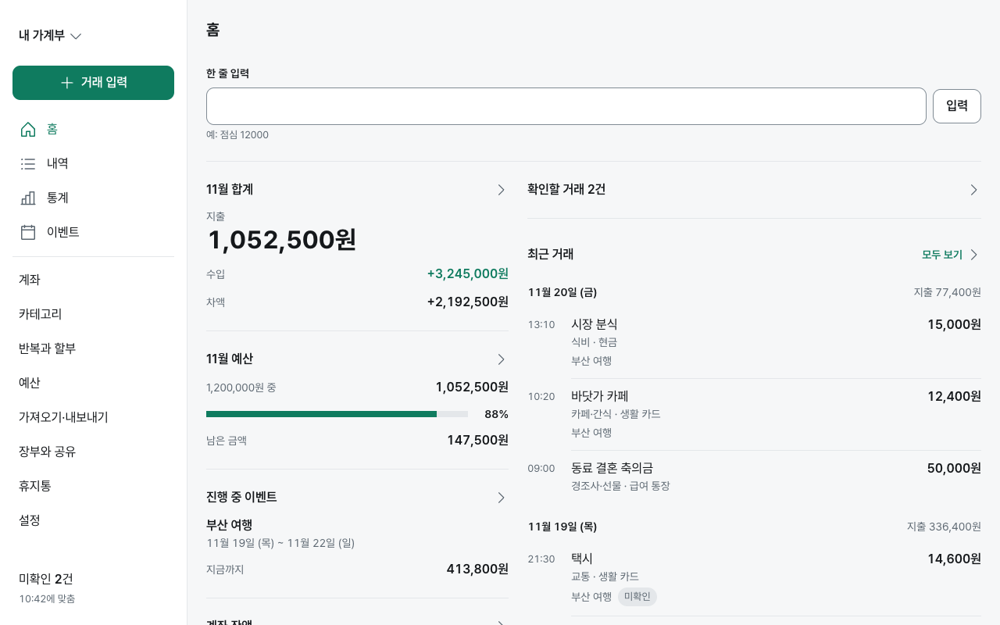
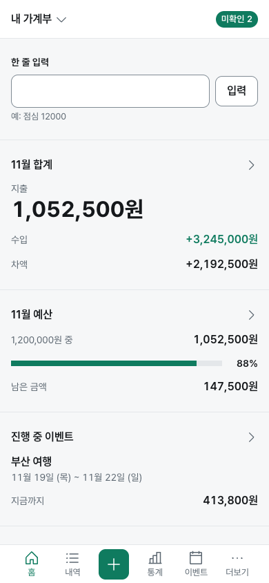

# 시안으로 고른 배치 결정

- 작성일: 2026-11-24
- 정정: 2026-11-23에 만든 홈 시안은 와이어프레임과 화면설계서 공통편만 보고 만들어 화면설계서 01 C-01(홈)과 달랐다.
- 정정: 2026-11-24에 designer가 시안을 화면설계서에 맞게 바로잡고 결정 13~17을 정했다([이슈 #102](https://github.com/lomong7807/akkimpyo/issues/102)). 그림 3장을 새 그림 2장으로 바꿨다.
- 세부: 2026-11-24에 designer가 설계서 문장끼리 어긋나거나 수치가 없던 세부 8건을 더 정했다(이슈 #102). 5절 L-11~L-17에 적고 1~4절의 수치에 반영했다.
- 상태: owner가 시안 이미지를 보고 고른 배치 결정(10~12)과 designer 결정(13~17)을 수치로 적는다.
- 시안은 설계서 토큰과 owner가 추가한 2색으로 만들었고 데이터는 목업 홈과 같다.
- 그림은 참고이고 기준은 이 문서의 수치다. 시안을 바꾸려면 이 문서의 수치를 고치고 그림을 다시 찍는다.
- "시안에서 쓴 값"이라고 적힌 수치는 설계서에 없어 designer가 시안에 넣었고 owner가 시안으로 고른 값이다.
- 설계서와 다른 곳은 5절 확인 필요에 모았다. 이 폴더는 `docs/planning`을 고치지 않는다.

| 결정 | 정한 사람 | 다루는 절 | 그림 |
|------|-----------|-----------|------|
| 10 넓은 화면의 홈 | owner | 1절 | [home-1280x800](drafts/2026-11-24-home-1280x800.png) |
| 11 하단 탭의 거래 입력 칸 | owner | 2절 | [home-390x844](drafts/2026-11-24-home-390x844.png) |
| 12 휴대폰의 묶음 사이 24px | owner | 3절 | [home-390x844](drafts/2026-11-24-home-390x844.png) |
| 13 홈의 구역 나누기 | designer | 4.1 | 두 그림 모두 |
| 14 홈의 이번 달 합계 | designer | 4.2 | 두 그림 모두 |
| 15 넓은 화면의 홈과 사이드바 수치 | designer | 1절 | [home-1280x800](drafts/2026-11-24-home-1280x800.png) |
| 16 거래 입력 칸이 보이는 범위 | designer | 2절 | 없음 |
| 17 홈의 예산 막대 색 | designer | 4.3 | 두 그림 모두 |

## 1. 넓은 화면(1024px 이상)의 홈 (owner 결정 10, designer 결정 15)

그림: [drafts/2026-11-24-home-1280x800.png](drafts/2026-11-24-home-1280x800.png)

- 결정 10에서 남는 것: 왼쪽 사이드바, 전체 폭 한 줄 입력, 그 아래 두 칸, 두 칸은 따로 스크롤하지 않고 내용 영역 전체가 함께 스크롤된다(시안에서 쓴 값). 카드, 오른쪽 440px, 사이드바 수치, 지금 화면 줄의 굵기 600은 결정 13과 15로 바뀌었다.
- 틀: 상단 바가 없다(설계서 6.1). 왼쪽 사이드바 폭 240px(설계서 2.5), 오른쪽 내용 영역. 내용 영역 여백 24px(설계서 2.4).
- 내용 영역: 맨 위에 화면 이름 "홈"(`text-title`), 그 아래 한 줄 입력을 전체 폭으로 두고, 그 아래를 두 칸으로 나눈다. 화면 이름 아래 간격은 8px이다(L-13).
- 두 칸: 왼쪽 칸은 내용 폭의 40%(화면설계서 01 C-01), 오른쪽 칸은 나머지, 칸 사이 24px. 폭은 내용 영역 안쪽 폭에서 칸 사이 24px을 뺀 나머지를 2:3으로 나눈다(1280px 창에서 왼쪽 387px). 홈은 두 칸이라 설계서 2.5의 720px 제한을 적용하지 않는다(L-13).
- 왼쪽 칸: 이번 달 합계, 예산, 진행 중 이벤트, 계좌 잔액. 오른쪽 칸: 확인할 거래, 최근 거래.
- 구역은 카드로 감싸지 않는다. 구역 사이의 선은 칸의 폭이다(결정 13, 4.1).
- 사이드바는 화면설계서 00-common 6.1~6.7 수치를 따른다. 설계서에 없는 값은 designer 결정이다(L-14). 구성과 순서는 다음과 같다.

| 자리(위에서부터) | 수치 | 근거 |
|------------------|------|------|
| 사이드바 안쪽 | 여백 위아래 24px, 좌우 16px, 요소 사이 16px | designer 결정(L-14) |
| 장부 전환기 | `text-body-strong` | 6.3 |
| "거래 입력" 주 버튼 | 높이 44px | 6.4의 4-1 |
| 메뉴 줄(주 메뉴와 더보기 항목) | 안쪽 좌우 8px | designer 결정(L-14) |
| 주 메뉴 4개 | 아이콘 24px과 이름, 사이 12px | 6.2의 5-1~5-4, designer 결정(L-14) |
| 더보기 항목 | 줄 높이 44px, 아이콘 없이 이름만 | 6.2의 5-6 |
| 맨 아래 묶음 | "미확인 {N}건"과 마지막으로 맞춘 시각 | 6.7의 3-1, 6.5의 2-3 |

- 지금 화면 줄은 설계서 6.2대로 강조한다. 색만 `color-accent`로 바꾸고 굵기는 바꾸지 않는다(하단 탭과 같다. [components.md](components.md) 10절 C-8, L-14).
- 버린 안(결정 10): 한 칸을 가운데 720px로 두는 배치. 이유: 최근 거래가 첫 화면에서 보이지 않는다.
- 버린 안(결정 15): 오른쪽 칸 440px 고정, 11-23 시안의 사이드바 값(아이콘 있는 더보기 항목, 48px 버튼, 장부 이름 `text-title`), 카드. 이유: 설계서 값이 아니고 1024~1111px 폭에서 수치가 맞지 않는다.
- 버린 안(세부): 지금 화면 줄의 굵기 600(결정 10). 이유: 하단 탭과 같게 색만 바꾼다.
- 정해진 세부: 5절 L-9, L-13, L-14. 확인 필요: 5절 L-18.

## 2. 빠른 입력 버튼은 하단 탭의 가운데 칸 (owner 결정 11, designer 결정 16)

그림: [drafts/2026-11-24-home-390x844.png](drafts/2026-11-24-home-390x844.png). 이 그림 한 장이 결정 11, 12, 13, 14를 함께 보여 준다.

- 휴대폰 배치(1024px 미만)에서 빠른 입력 버튼은 떠 있지 않고 하단 탭의 한 칸이다.
- 모양: 44x44px, `color-accent` 바탕, `color-on-accent` Plus 아이콘 24px, 모서리 10px, 그림자 없음, 글자 없음. 접근성 이름 "거래 입력". 칸 안에서 가운데.
- 칸 순서: 홈, 내역, 거래 입력, 통계, 이벤트, 더보기(6칸, 같은 폭). 이벤트 탭이 없는 1단계는 홈, 내역, 거래 입력, 통계, 더보기(5칸).
- 보이는 범위(designer 결정 16): 하단 탭이 보이는 모든 화면에서 보이고 보기 전용 구성원에게만 숨긴다.
- 권한을 아직 모를 때(L-16): 거래 입력 칸의 자리를 비워 두고(다른 탭의 자리는 그대로), 보기 전용으로 확인되면 칸을 없애고 나머지 탭을 같은 폭으로 다시 나눈다.
- 떠 있는 버튼이 없어지므로 내용 아래 여백은 버튼 몫을 빼고 24px이다. 토스트는 하단 탭 위 16px, 좌우 여백 16px의 폭이다.
- 넓은 화면은 그대로 사이드바의 "거래 입력" 버튼이다.
- 버린 안(결정 11): (1) 하단 탭 위에 전체 폭 "거래 입력" 줄을 두는 안. 이유: 모든 화면에서 내용 높이가 65px 줄어든다. (2) 떠 있는 버튼을 그대로 두는 안. 이유: 스크롤 중 목록의 금액을 가린다(390x844에서 `npx impeccable detect`가 금액 83% 가림으로 잡음).
- 버린 안(결정 16): 설정과 공통 상태 화면에서 숨김(와이어프레임 00-common 3.1). 이유: 화면에 따라 탭 칸 수가 바뀌면 탭 위치가 움직인다.
- 확인 필요: 5절 L-2, L-3, L-8, L-18. L-1은 결정 16으로, L-16은 세부로 결정됨.

## 3. 휴대폰 배치의 묶음 사이 간격 (owner 결정 12)

그림: 2절의 [drafts/2026-11-24-home-390x844.png](drafts/2026-11-24-home-390x844.png)

- 홈처럼 묶음이 위아래로 쌓이는 화면에서 묶음 사이는 24px이다(설계서 2.4). 첫 묶음 위도 24px. 이 24px은 구역의 내용과 경계 사이로 읽는다(L-11). 홈에서는 선 위아래에 각각 24px이다.
- 홈의 묶음은 상자나 흰 면으로 감싸지 않고 구분선과 여백으로 나눈다(designer 결정 13, 4.1). 좌우 여백은 16px, 묶음 안 요소 사이는 12px이다. 다른 화면은 화면별 설계서와 와이어프레임 00-common 4절 규칙 7을 따른다.
- 버린 안: 8px(목업의 값). 이유: 설계서 값이 아니고 묶음의 경계가 덜 분명하다.

## 4. 홈의 구역, 이번 달 합계, 예산 막대 (designer 결정 13, 14, 17)

그림: 휴대폰은 2절의 [drafts/2026-11-24-home-390x844.png](drafts/2026-11-24-home-390x844.png), 넓은 화면은 1절의 [drafts/2026-11-24-home-1280x800.png](drafts/2026-11-24-home-1280x800.png)

### 4.1 구역 나누기 (결정 13)

- 홈의 구역은 상자로 감싸지 않고 구분선과 여백으로 나눈다(화면설계서 01 C-01).
- 구역 사이에 1px `color-border` 선, 선 위아래에 각각 여백 24px. 구역 안 요소 사이 12px.
- 휴대폰에서 선은 화면 좌우 끝까지 닿는다. 넓은 화면에서 선은 칸의 폭이다(L-11).
- 휴대폰 좌우 여백 16px, 넓은 화면 내용 영역 여백 24px.
- 버린 안: 흰 면 묶음과 카드(11-23 시안). 이유: 설계서 정의와 다르고 상자가 늘어난다.

### 4.2 이번 달 합계 (결정 14)

- 지출만 큰 숫자다: `text-hero`, 왼쪽 정렬, 위에 "지출" 레이블(`text-secondary`).
- 그 아래 수입과 차액은 줄이다.
- 큰 숫자는 줄의 금액이 아니라 화면의 머리 숫자라 왼쪽 정렬이다. 금액 오른쪽 정렬 규칙은 이름과 금액이 한 줄에 있는 줄에 적용한다(L-12).
- 큰 숫자는 줄바꿈하지 않고, 칸 폭을 넘으면(글자 크기 200% 등) `text-title` 크기로 내린다. 구현 검토 때 200%에서 확인한다(L-12).
- 화면설계서 01 C-01 (2)의 세 줄과 다르다. 설계서 수정 필요 목록(5절 L-2)에 넣었다.
- 버린 안: 수입, 지출, 차액 세 줄. 이유: 홈에서 가장 먼저 보일 것이 하나 서야 하고 공통편에 "홈의 큰 금액" 글자 단계가 이미 있다.
- 확인 필요: 5절 L-2.

### 4.3 예산 막대 (결정 17)

- 홈의 예산 막대 채움은 `color-accent`, 초과하면 `color-danger`다(화면설계서 01 C-01 (3)).
- 공통편 2.6의 "지출 막대는 `color-text-secondary`"는 통계 그래프에 적용한다.
- 버린 안: 회색 막대(11-23 시안).

### 4.4 설계서대로 바로잡은 것 (정정과 세부)

| 곳 | 바로잡은 모양 | 설계서 |
|----|---------------|--------|
| 홈 한 줄 입력의 "입력" | 보조 버튼(높이 44px) | 01 C-01 (1), 00-common 5.1 |
| 상단 바의 장부 이름 | `text-body-strong` | 00-common 6.3 |
| 미확인 배지 | 00-common 6.7의 모양 | 00-common 6.7의 3 |
| 홈의 거래 줄 | 02의 0.4(거래 줄 공통 부품)를 따른다. 둘째 줄은 "카테고리 · 계좌", 셋째 줄에 이벤트 이름(보조 글자)과 상태 칩이 온다. "미확인"은 표시 칩이다(L-15) | 02의 0.4, 01 C-01 (9) |
| 아이콘 | 내역 ListBullets, 이벤트 CalendarBlank(L-17) | 00-common 6.2의 5-2, 5-4 |
| 한 줄 입력의 도움말 | 입력칸 아래 4px(L-17) | 00-common 2.4, 5.2 |

- 버린 안(세부): "미확인"을 보조 글자로. 이유: 02의 0.4와 00-common 5.11은 칩이다.

## 5. 확인 필요

"열림"인 항목은 정해지기 전에는 구현에서 임의로 정하지 않는다(누가 정하는지는 [README](README.md) 6절). 정해진 항목은 지우지 않고 상태를 바꿔 남긴다. L-1과 L-2는 designer가 적었고, L-3부터는 이 문서를 옮겨 쓰며 설계서, 와이어프레임, 시안 CSS와 대조하다 찾은 것이다(값은 정하지 않았다). L-10부터는 2026-11-24 정정 때 더했다.

| # | 상태 | 내용 | 관련 |
|---|------|------|------|
| L-1 | 결정됨(designer 결정 16, 2026-11-24) | 설계서는 빠른 입력 버튼을 M 그룹(설정), N 그룹 화면에서 숨긴다(와이어프레임 00-common 3.1). 탭의 한 칸이 되면 화면에 따라 탭 칸 수가 바뀌어 탭 위치가 움직인다. 결정: 하단 탭이 보이는 모든 화면에서 보이고 보기 전용 구성원에게만 숨긴다 | 결정 11, 16 |
| L-2 | 열림(설계서 수정) | 설계서 수정 필요 목록이다. 결정 11에 맞춰 고쳐야 하는 기준 문서: 와이어프레임 00-common 3.1의 (4)와 (5), 화면설계서 00-common의 2.4(빠른 입력 버튼 그림자와 56x56px), 5.7(토스트 폭), 6.1(내용 아래 여백), 6.2(B-01), 6.4(B-03), 기능정의서 F-102. 결정 14에 맞춰 고쳐야 하는 기준 문서: 화면설계서 01 C-01 (2), C-01의 "금액은 모두 숫자 폭 고정(tabular-nums), 오른쪽 정렬"과 데이터 없음의 "수입 0원", "지출 0원", "차액 0원" 순서, 00-common 2.2의 금액 정렬, 와이어프레임 00-common 4절 규칙 4, 와이어프레임 01 C-01 그림의 (2). 결정 16에 맞춰 고쳐야 하는 기준 문서: 기능정의서 F-102와 와이어프레임 00-common 3.1의 보이는 범위. L-11에 맞춰: 화면설계서 00-common 2.4의 "묶음(섹션) 사이 24px"(읽는 법). L-13에 맞춰: 화면설계서 00-common 2.5의 720px 제한(홈은 적용하지 않음). L-15에 맞춰: 화면설계서 01 C-01 (9)와 (10)의 둘째 줄, 와이어프레임 01 C-01 그림의 (10), 화면설계서 02 0.4의 쓰는 곳(C-01이 없다). 이 폴더는 `docs/planning`을 고치지 않는다 | 결정 11, 14, 16, L-11, L-13, L-15 |
| L-3 | 열림(설계서 수정) | L-2 말고도 떠 있는 빠른 입력 버튼을 적은 곳이 더 있다(grep으로 찾음): 화면설계서 00-common 2.5의 두 줄(768px 미만, 768px 이상 1024px 미만), 2.6의 층 순서, 6.1의 표 (4), 6.6의 B-05 공통 틀 줄, 9절 판단 47과 54, IA 2절 B-03, 화면설계서 01과 와이어프레임 01의 "공통 틀" 줄들(M 그룹, N 그룹, A-08, A-09에 "빠른 입력 버튼은 없다") | 결정 11 |
| L-4 | 결정됨(설계서를 따름, designer 결정 15, 2026-11-24) | 결정 10의 처음 수치가 기준 문서와 달랐다: 화면설계서 01 C-01의 넓은 화면(왼쪽이 "내용 폭의 40%"), C-01의 "구역은 상자로 감싸지 않고 구분선과 여백으로 나눈다"와 와이어프레임 00-common 4절 규칙 7(상자는 꼭 필요한 곳에만), 00-common 6.2의 5-6(더보기 항목은 "아이콘 없이 이름만"), 6.3(장부 전환기 이름은 `text-body-strong`), 6.4의 4-1(사이드바 거래 입력 버튼 높이 44px), 6.7의 3-1(사이드바 글자는 "미확인 {N}건", `text-body`). 결정: 모두 설계서를 따른다(상자는 결정 13). 이 항목으로 고칠 기준 문서는 없다 | 결정 10, 13, 15 |
| L-5 | 결정됨(홈, designer 결정 15, 2026-11-24) | 결정 10의 처음 수치로는 폭 1024px 이상 1112px 미만에서 왼쪽 칸 최소 360px을 지킬 수 없었다(사이드바 240 + 여백 24 + 왼쪽 360 + 간격 24 + 오른쪽 440 + 여백 24 = 1112px). 결정: 왼쪽 칸은 내용 폭의 40%다. 목록 화면에 남는 것은 L-10 | 결정 10, 15 |
| L-6 | 결정됨(항목별, 2026-11-24) | 11-23 시안의 그림이 설계서와 달랐던 곳과 결정: (1) "입력" 버튼이 주 버튼이라 넓은 화면에 주 버튼이 둘이었다: 설계서대로 보조 버튼이다(화면설계서 01 C-01 (1)). (2) 이번 달 합계가 지출(`text-hero`), 수입, 차액 순서였다: 결정 14. (3) 예산 막대의 채움이 `color-text-secondary`였다: 결정 17. (4) 휴대폰 상단 바의 장부 이름이 20px, 700이고 확인할 거래가 아이콘과 숫자였다: 설계서대로 한다(00-common 6.3, 6.7) | 결정 14, 17, 4.4 |
| L-7 | 해당 없음(시안 값 삭제, 2026-11-24) | 11-23 시안 CSS에는 있으나 결정의 수치에 없는 간격이 있었다: 사이드바 메뉴 줄과 장부 전환기의 좌우 안쪽 8px, 메뉴 구분선의 위아래 8px, 맨 아래 건수와 시각 사이 4px, 하단 탭의 좌우 16px(390px에서 칸 폭 약 60px) | 결정 10, 11 |
| L-8 | 열림 | 6칸일 때 거래 입력은 셋째 칸이라 한가운데가 아니다. 한가운데가 되는 것은 1단계의 5칸이다. 2절 제목의 "가운데 칸"과 칸 순서가 어긋나며, 순서는 결정 11에 적힌 대로 두었다 | 결정 11 |
| L-9 | 결정됨(designer 결정 15, 2026-11-24) | 사이드바 맨 아래 묶음의 "보내지 않은 입력 {N}건"(화면설계서 6.5의 2-4)은 시안에 보이지 않고 결정 10에 자리와 모양이 없었다. 사이드바 더보기 항목 8개의 아이콘 이름도 화면설계서에 없다(6.2는 아이콘을 두지 않는다). 결정: 보내지 않은 입력 줄은 00-common 6.5의 2-4를 따르고, 더보기 항목에는 아이콘을 두지 않는다 | 결정 10, 15 |
| L-10 | 열림(내역 화면 시안을 만들 때 designer가 정한다) | L-5에 함께 적었던 것 가운데 목록 화면에 남는 것: 설계서 2.5의 목록 칸 최소 360px과 오른쪽 칸 440px을 더하면 800px이라 1024px 폭의 내용 영역 784px보다 크다. 결정 15는 홈만 정한다 | 설계서 2.5 |
| L-11 | 결정됨(designer 2026-11-24) | 결정 12의 "묶음 사이 24px"과 결정 13의 "선 위아래 여백 24px"을 함께 두면 위아래 두 구역의 내용 사이는 24 + 1 + 24 = 49px이다. 설계서 2.4의 "묶음(섹션) 사이 24px"을 선 한쪽의 여백으로 읽는지, 휴대폰의 선이 화면 좌우 끝까지 닿는지 적혀 있지 않았다. 결정: 구역 사이는 1px `color-border` 선이고 선 위아래에 각각 24px을 둔다. 결정 12의 24px은 "구역의 내용과 경계 사이"로 읽는다. 휴대폰에서 선은 화면 좌우 끝까지 닿는다. 넓은 화면에서 선은 칸의 폭이다(그림에서 한 줄 입력 아래의 선은 두 칸에 걸친 992px이다) | 결정 12, 13 |
| L-12 | 결정됨(designer 2026-11-24) | 결정 14의 왼쪽 정렬이 C-01의 "금액은 모두 숫자 폭 고정(tabular-nums), 오른쪽 정렬"과 와이어프레임 00-common 4절 규칙 4와 달랐고, 글자를 200%로 키우면(설계서 2.3, F-903) 큰 숫자가 휴대폰 내용 폭을 넘을 수 있었다: 그림에서 잰 "1,052,500원"이 약 185px이라 두 배면 약 370px이고 390px 폭의 내용 폭은 358px이다(추정). 결정: 큰 숫자는 줄의 금액이 아니라 화면의 머리 숫자라 왼쪽 정렬이다. 금액 오른쪽 정렬 규칙은 "이름과 금액이 한 줄에 있는 줄"에 적용한다. 큰 숫자는 줄바꿈하지 않고, 칸 폭을 넘으면(글자 크기 200% 등) `text-title` 크기로 내린다. 구현 검토 때 200%에서 확인한다. 고칠 기준 문서는 L-2 | 결정 14 |
| L-13 | 결정됨(designer 2026-11-24) | "내용 폭의 40%"에서 내용 폭이 무엇인지 적혀 있지 않았다(1280px 화면에서 여백을 뺀 992px의 40%는 396.8px, 여백을 포함한 1040px의 40%는 416px). 설계서 2.5는 목록 화면이 아니면 내용 폭을 가운데 720px로 제한한다. 결정: 두 칸의 폭은 내용 영역 안쪽 폭에서 칸 사이 24px을 뺀 나머지를 2:3으로 나눈다(1280px 창에서 왼쪽 387px). 홈은 두 칸이라 2.5의 720px 제한을 적용하지 않는다. 화면 이름 아래 간격은 8px이다 | 결정 15 |
| L-14 | 결정됨(designer 2026-11-24) | 사이드바에 설계서 6.1~6.7로 정해지지 않는 값이 있었고(2.4의 아이콘 크기에는 사이드바가 없다), 지금 화면 줄의 글자 굵기가 결정 10(600)과 C-8(색만)에서 달랐다. 결정: 안쪽 여백 위아래 24px, 좌우 16px, 요소 사이 16px, 메뉴 줄 안쪽 좌우 8px, 주 메뉴 아이콘 24px과 이름 사이 12px. 지금 화면 줄은 색만 `color-accent`로 바꾸고 굵기는 바꾸지 않는다(하단 탭과 같다). 버린 안: 지금 화면 줄의 굵기 600. 남은 값은 L-18 | 결정 10, 15, [components.md](components.md) C-8 |
| L-15 | 결정됨(designer 2026-11-24) | 거래 줄의 정의가 설계서끼리 달랐다. "미확인"은 01 C-01 (9)에서는 둘째 줄 보조 글자이고, 00-common 5.11과 02의 0.4, D-01 (11)에서는 칩이다. 결제한 사람과 이벤트 이름은 C-01 (9)에서는 둘째 줄, 02의 0.4에서는 셋째 줄이다. 결정: 거래 줄은 화면설계서 02의 0.4(거래 줄 공통 부품)를 따른다. 둘째 줄은 "카테고리 · 계좌", 셋째 줄에 이벤트 이름(보조 글자)과 상태 칩이 온다. "미확인"은 표시 칩이다. C-01 (9)도 "줄 구성은 내역(F-215)과 같다"고 적으므로 0.4가 기준이다. 버린 안: "미확인"을 보조 글자로. 고칠 기준 문서는 L-2 | 4.4 |
| L-16 | 결정됨(designer 2026-11-24) | 설계서 6.4는 현재 장부의 권한을 아직 모르면(앱을 처음 열 때) 빠른 입력 버튼을 그리지 않는다. 하단 탭에 그대로 쓰면 권한을 받는 순간 칸 수가 늘어 탭 위치가 움직인다. 결정: 권한을 아직 모를 때는 거래 입력 칸의 자리를 비워 두고(다른 탭의 자리는 그대로), 보기 전용으로 확인되면 칸을 없애고 나머지 탭을 같은 폭으로 다시 나눈다 | 결정 11, 16 |
| L-17 | 결정됨(designer 2026-11-24) | 앞선 그림이 설계서와 다른 곳이 있었다: 내역 아이콘(영수증 모양), 휴대폰 이벤트 탭 아이콘(별이 든 달력), 한 줄 입력의 칸과 도움말 사이(8px). 결정: 아이콘과 간격은 설계서를 따른다(내역 ListBullets, 이벤트 CalendarBlank, 도움말은 입력칸 아래 4px). 새 그림은 이 값으로 찍었다 | 그림 두 장 |
| L-18 | 열림 | 그림에는 있으나 결정과 설계서에 없거나 다른 값이 남아 있다: (1) 사이드바 주 메뉴 줄의 높이와 글자 단계(그림 44px, `text-body`). (2) 메뉴 구분선의 위아래(그림 8px), 사이드바 맨 아래 건수와 시각 사이(그림 4px), 하단 탭의 좌우 안쪽(그림 16px), 거래 줄의 둘째 줄과 셋째 줄 사이(그림 4px). (3) 넓은 화면 홈의 거래 줄 좌우 안쪽(그림 0, 설계서 2.4의 목록 줄은 16px). (4) 화면 이름 아래 8px(L-13) 다음에 첫 구역의 위 여백 24px이 더 붙는지(그림은 붙어서 이름과 "한 줄 입력" 사이가 32px) | 결정 15, L-13, L-14, L-15 |
