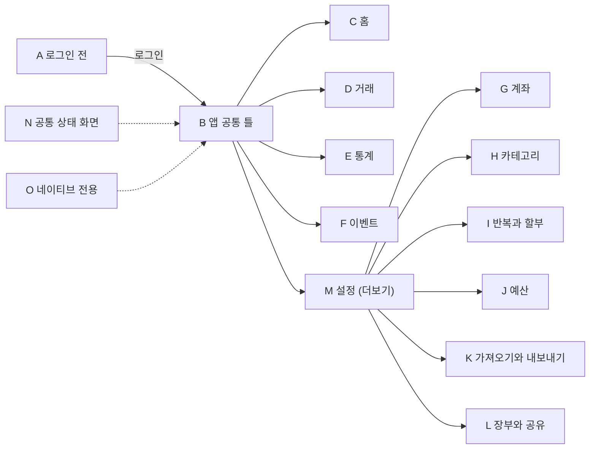

# 가계부 앱 정보구조도(IA)

- 작성일: 2026-11-18
- 상태: 초안, 사용자 확인 전
- 근거 문서: [설계 문서](../superpowers/specs/2026-11-18-account-book-design.md), [프로젝트 개요서](01-project-overview.md)
- 표기:
  - 화면 ID는 그룹 문자와 두 자리 번호이다. 예: `A-01`
  - 화면 이름 뒤의 `[1]` `[2]` `[3]` `[4]` `[출시]` 는 그 화면이 들어가는 단계이다. 1은 혼자 쓰는 가계부, 2는 이벤트와 공유, 3은 입력 줄이기, 4는 네이티브 앱, 출시는 출시 준비이다.
  - 한 화면 안의 일부 요소만 뒤 단계이면 그 요소 뒤에 단계를 붙인다.
  - `[미결]` 은 사용자 결정이 필요한 사항이다. 무엇이 미결인지 함께 적는다.
  - 화면이 아니라 화면 안의 요소나 동작은 번호 없이 화면 설명에 적는다.

## 1. 한눈에 보는 구조

로그인 전 화면(A)과 로그인 후 화면을 나누고, 로그인 후에는 앱 공통 틀(B)이 모든 화면을 감싼다. 주 내비게이션은 홈, 내역, 통계, 이벤트, 더보기이고, 나머지 화면은 대부분 더보기(M)에서 들어간다.

## 2. 화면 트리

### A. 로그인 전

- A-01 소개 페이지 `[출시]` `[미결]` 비로그인 범위가 정해지지 않았다. 제안은 "로그인 전에는 A 그룹 화면만 보인다"이다.
- A-02 로그인 `[1]`
- A-03 가입 `[1]`: 이메일, 비밀번호, 표시 이름, 약관 동의 `[출시]` 를 입력한다. 1단계에는 가입이 닫혀 있고 허용된 이메일만 가입한다.
  - A-04 이메일 인증 안내·완료 `[출시]`
- A-05 비밀번호 재설정 요청 `[출시]`
  - A-06 새 비밀번호 설정 `[출시]`
- A-07 초대 링크 착지 화면 `[2]`: 로그인 전에는 장부 이름과 초대한 사람을 보여주고 로그인·가입으로 안내한다. 로그인 후에는 수락 또는 거절을 고른다.
- A-08 이용약관 `[출시]`
- A-09 개인정보 처리방침 `[출시]` `[미결]` 처리방침 내용이 정해지지 않았다.

### B. 앱 공통 틀

화면이 아니라 모든 화면에 걸친 틀이다. ID는 요소별로 매긴다.

- B-01 주 내비게이션 `[1]`: 홈, 내역, 통계, 이벤트 `[2]`, 더보기. 휴대폰 폭에서는 하단 탭, 넓은 화면에서는 왼쪽 사이드바이다.
- B-02 장부 전환기 `[2]`: 현재 장부를 고른다. "내 전체 지출"로 이동하고 장부 만들기로 이동한다.
- B-03 빠른 입력 버튼 `[1]`: 어느 화면에서든 거래 입력을 연다.
- B-04 동기화 상태 표시 `[1]`: "보내지 않은 입력 N건"과 마지막으로 서버와 맞춘 시각을 보여준다.
  - B-05 보내지 않은 입력 목록 `[1]`: 다시 보내기, 버리기.
- B-06 미확인 건수 배지 `[3]`

### C. 홈

- C-01 홈 `[1]`: 이번 달 수입·지출 합계, 계좌 잔액 요약, 최근 거래, 한 줄 입력창을 둔다. 진행 중 이벤트 `[2]`, 예산 진행 `[3]`, 미확인 건수 `[3]` 도 보인다.

### D. 거래

- D-01 내역 `[1]`: 월 이동과 필터를 쓴다. 필터는 계좌, 카테고리, 유형, 상태, 결제한 사람 `[2]`, 이벤트 `[2]` 이다.
- D-02 달력 `[1]`: 날짜별 합계를 보여준다. 날짜를 누르면 그날 거래를 보여준다.
- D-03 검색 `[1]`
- D-04 거래 입력·수정 `[1]`: 지출, 수입, 이체를 입력한다. 분할 입력 `[3]`, 할부 `[3]`, 반복으로 만들기 `[3]` 가 있다.
- D-05 한 줄 입력 결과 확인 `[1]`: "점심 12000" 을 해석한 결과를 보여주고 저장하거나 고친다.
- D-06 거래 상세 `[1]`: 수정, 승인취소와 되돌리기, 삭제가 있다. 이벤트 소속 바꾸기(자동, 포함, 제외) `[2]` 와 환불 연결 `[3]` 도 여기서 한다.
  - D-07 변경 이력 `[1]`
- D-08 휴지통 `[1]`: 삭제한 거래 목록을 보여주고 복원한다.
- D-09 미확인 검토 목록 `[3]`: 확인, 고치기, 계좌 지정, 합치기 제안 수락·거절, 삭제를 한다.
- D-10 일괄 수정 `[3]`: 넓은 화면 전용이다.

### E. 통계

- E-01 월별 통계 `[1]`
- E-02 카테고리별 통계 `[1]`: 카테고리를 누르면 해당 거래 목록을 보여준다. 이벤트 지출 제외 보기 `[2]` 가 있다.
- E-03 결제한 사람별 합계 `[2]`
- E-04 예산 대비 `[3]`

### F. 이벤트

그룹 전체가 `[2]` 이다.

- F-01 이벤트 목록 `[2]`: 진행 중, 예정, 지난 것으로 나눈다.
- F-02 이벤트 만들기·수정 `[2]`: 이름과 시작·종료 일시를 정한다. 같은 장부의 다른 이벤트와 기간이 겹치면 저장할 수 없다.
- F-03 이벤트 상세 `[2]`: 합계, 하루 평균, 카테고리별 합계, 묶인 거래, 제외한 거래를 보여준다. 거래 포함·제외와 이벤트 삭제도 여기서 한다.

### G. 계좌

- G-01 계좌 목록 `[1]`: 은행, 카드, 현금별 잔액을 보여준다.
- G-02 계좌 추가·수정 `[1]`: 이름, 종류, 시작 잔액과 기준일, 카드 식별 문구 `[3]` 를 입력한다.
- G-03 계좌 상세 `[1]`: 잔액과 그 계좌의 거래를 보여주고 계좌를 삭제한다.

### H. 카테고리

- H-01 카테고리 관리 `[1]`: 수입·지출 구분, 2단계 구조, 추가, 이름 바꾸기, 삭제를 한다.

### I. 반복과 할부

그룹 전체가 `[3]` 이다.

- I-01 반복 거래 목록 `[3]`: 중지, 다시 시작, 삭제를 한다.
- I-02 반복 거래 추가·수정 `[3]`
- I-03 할부 목록 `[3]`: 진행 중인 할부와 남은 회차를 보여준다.

### J. 예산

그룹 전체가 `[3]` 이다.

- J-01 월 예산 설정 `[3]`: 전체와 카테고리별 예산을 정하고 수정, 삭제한다.

### K. 가져오기와 내보내기

- K-01 엑셀·CSV 내보내기 `[1]`
- K-02 카드사 엑셀 가져오기, 파일 선택 `[3]`
- K-03 카드사 엑셀 가져오기, 미리보기와 열 맞추기 `[3]`
- K-04 카드사 엑셀 가져오기, 결과 `[3]`: 들어온 건수와 건너뛴 건수를 보여주고 미확인 검토 목록(D-09)으로 이동한다.

K-02, K-03, K-04는 파일 선택, 미리보기와 열 맞추기, 결과 순으로 이어지는 세 단계이다.

### L. 장부와 공유

그룹 전체가 `[2]` 이다.

- L-01 장부 목록 `[2]`
- L-02 장부 만들기 `[2]`
- L-03 내 전체 지출 `[2]`: 내가 속한 모든 장부에서 내가 결제한 거래의 합계를 보여준다.
- L-04 장부 설정 `[2]`: 이름 바꾸기, 장부 나가기, 장부 삭제. 이름 바꾸기와 삭제는 소유자만 할 수 있다.
  - L-05 구성원 목록 `[2]`: 구성원 내보내기는 소유자만 할 수 있다.
  - L-06 초대 만들기 `[2]`: 링크 또는 코드를 만들고 만료 시각을 정한다.
  - L-07 대기 중인 초대 목록 `[2]`: 초대를 취소한다.
- L-08 코드로 참여 `[2]`

### M. 설정

더보기 탭 아래에 둔다.

- M-01 더보기 메뉴 `[1]`: G, H, I, J, K, L 그룹, 휴지통(D-08), 설정으로 가는 목록이다.
- M-02 프로필 `[1]`: 표시 이름, 비밀번호 바꾸기, 로그아웃.
- M-03 화면 설정 `[1]`: 테마를 시스템 따름, 밝게, 어둡게 중에서 고른다.
- M-04 문자 자동 입력 설정 `[3]`: 전송 주소 발급, 다시 발급, 끄기, 받을 장부 지정, 단축어 설정 안내.
- M-05 회원 탈퇴 `[출시]` `[미결]` 탈퇴 시 데이터 처리가 정해지지 않았다.
- M-06 앱 잠금 설정 `[4]`: Face ID를 쓰며 네이티브 전용이다.

### N. 공통 상태 화면

- N-01 찾을 수 없음 `[1]`
- N-02 접근 권한 없음 `[2]`: 내보내졌거나 나간 장부를 열려고 할 때 보인다.
- N-03 서버 오류·연결 없음 안내 `[1]`
- N-04 수정 충돌 안내 `[1]`: 다른 기기에서 먼저 고친 거래를 저장하려 할 때 보인다. 최신 내용 보기 또는 내 입력 다시 적용을 고른다.

### O. 네이티브 전용

그룹 전체가 `[4]` 이다.

- O-01 홈 화면 위젯 `[4]`

화면 ID는 모두 64개이다.

| 그룹 | 개수 |
|------|------|
| A 로그인 전 | 9 |
| B 앱 공통 틀 | 6 |
| C 홈 | 1 |
| D 거래 | 10 |
| E 통계 | 4 |
| F 이벤트 | 3 |
| G 계좌 | 3 |
| H 카테고리 | 1 |
| I 반복과 할부 | 3 |
| J 예산 | 1 |
| K 가져오기와 내보내기 | 4 |
| L 장부와 공유 | 8 |
| M 설정 | 6 |
| N 공통 상태 화면 | 4 |
| O 네이티브 전용 | 1 |

## 3. 내비게이션

- 주 내비게이션(B-01)은 홈(C-01), 내역(D-01), 통계(E-01), 이벤트(F-01) `[2]`, 더보기(M-01)로 구성된다.
- 휴대폰 폭에서는 하단 탭, 넓은 화면에서는 왼쪽 사이드바로 보인다.
- 장부 전환기(B-02) `[2]` 에서 현재 장부를 고르고, "내 전체 지출"(L-03)과 장부 만들기(L-02)로 이동한다.
- 빠른 입력 버튼(B-03)은 어느 화면에서든 거래 입력(D-04)을 연다.
- 동기화 상태 표시(B-04)는 "보내지 않은 입력 N건"과 마지막으로 서버와 맞춘 시각을 보여주고, 누르면 보내지 않은 입력 목록(B-05)으로 간다.
- 미확인 건수 배지(B-06) `[3]` 는 미확인 검토 목록(D-09)과 연결된다.
- 더보기(M-01)에서 계좌(G), 카테고리(H), 반복과 할부(I), 예산(J), 가져오기와 내보내기(K), 장부와 공유(L), 휴지통(D-08), 설정(M-02, M-03, M-04, M-05, M-06)으로 간다.

## 4. 반대편 화면 점검

| 행위 | 반대 행위 | 위치(화면 ID) | 상태 |
|------|-----------|---------------|------|
| 가입 | 회원 탈퇴 | A-03 / M-05 | 있음 |
| 로그인 | 로그아웃 | A-02 / M-02 | 있음 |
| 거래 만들기 | 삭제, 복원 | D-04 / D-06 / D-08 | 있음. 휴지통에서 완전히 지우기는 빈틈(5절 1번) |
| 승인취소 | 되돌리기 | D-06 | 있음 |
| 계좌 추가 | 삭제 | G-02 / G-03 | 있음. 거래가 있는 계좌 처리는 빈틈(5절 2번) |
| 카테고리 추가 | 삭제 | H-01 | 있음. 삭제 시 거래 처리는 빈틈(5절 3번) |
| 장부 만들기 | 장부 삭제 | L-02 / L-04 | 있음. 삭제 후 복구는 빈틈(5절 10번) |
| 초대 만들기 | 초대 취소 | L-06 / L-07 | 있음 |
| 초대 수락 | 장부 나가기, 내보내기 | A-07 / L-04 / L-05 | 있음. 소유자가 나가는 경우는 빈틈(5절 4번) |
| 이벤트 만들기 | 삭제 | F-02 / F-03 | 있음. 삭제 시 수동 포함 거래 처리는 빈틈(5절 13번) |
| 이벤트에 포함 | 제외, 자동으로 되돌리기 | D-06 / F-03 | 있음 |
| 엑셀 가져오기 | 가져오기 되돌리기 | K-02, K-03, K-04 | 빈틈(5절 5번) |
| 합치기 | 다시 나누기 | D-09 | 빈틈(5절 6번) |
| 미확인 확인 | 미확인으로 되돌리기 | D-09 | 빈틈(5절 15번) |
| 환불 연결 | 연결 해제 | D-06 | 거래 상세에 있음 |
| 반복 거래 시작 | 중지, 다시 시작 | I-01 / I-02 | 있음 |
| 예산 설정 | 삭제 | J-01 | 있음 |
| 문자 전송 주소 발급 | 끄기, 다시 발급 | M-04 | 있음 |
| 오프라인 입력 쌓기 | 다시 보내기, 버리기 | B-04 / B-05 | 있음 |
| 앱 잠금 켜기 | 끄기 | M-06 | 있음 |

5절의 7번(이메일 주소 바꾸기), 8번(기기 목록과 기기별 로그아웃), 9번, 11번, 12번, 14번은 위 표의 쌍에 속하지 않고 트리를 살피며 찾은 빈틈이다.

## 5. 기능정의서로 넘기는 빈틈

1. 휴지통에서 완전히 지우는 기능을 둘지, 휴지통 보관 기간을 둘지.
2. 거래가 있는 계좌를 삭제할 때의 처리. 삭제 대신 숨김(보관)을 둘지.
3. 카테고리를 삭제할 때 그 카테고리의 거래를 어디로 옮길지. 하위 카테고리가 있는 상위 카테고리 삭제.
4. 소유자가 장부를 나가려 할 때의 처리. 소유권 넘기기를 둘지.
5. 엑셀 가져오기 한 번을 통째로 되돌리는 기능.
6. 합친 거래를 다시 나누는 기능.
7. 이메일 주소 바꾸기.
8. 로그인된 기기 목록과 기기별 로그아웃.
9. 내보내진 구성원이 그 장부를 열어 둔 상태에서의 동작. 보내지 않은 입력이 남아 있을 때의 처리.
10. 삭제한 장부를 복구할 수 있는지.
11. 초대 링크 하나로 몇 명까지 들어올 수 있는지.
12. 가입 때 생기는 개인 장부를 삭제할 수 있는지. 마지막 남은 장부를 삭제하거나 나갈 수 있는지.
13. 이벤트를 삭제하거나 기간을 바꿀 때 수동으로 포함·제외한 거래의 처리.
14. 오프라인으로 쌓아 둔 입력을 서버가 거부할 때(계좌나 카테고리가 그사이 삭제된 경우)의 처리.
15. 확인한 자동 입력 거래를 다시 미확인으로 돌리는 기능이 필요한지.

페르소나 8명의 사용 케이스에서 나온 빈틈 G-16부터 G-28은 [페르소나와 사용 케이스](01a-personas.md) 3절에 있다. 번호는 위 목록에 이어진다. 사용자가 권고를 받아들이면 이 트리에 다음 화면과 요소가 추가된다.

- G-28을 받아들이면: 첫 실행 안내 화면(기본 카테고리 확인, 첫 계좌 만들기) `[1]`
- G-18을 받아들이면: E 그룹에 연 단위 통계 `[1]`
- G-16을 받아들이면: L-05 구성원 목록에 권한 바꾸기(편집 가능, 보기 전용) `[2]`
- G-21을 받아들이면: F-03 이벤트 상세에 이벤트 복제 `[2]`
- G-19를 받아들이면: D-04 거래 입력에 "돌려받음" 선택 항목 `[1]`
- G-24, G-27을 받아들이면: L-04 나가기 확인과 L-06 초대 만들기에 안내 문구 `[2]`

## 6. 체크리스트 결과

| 항목 | 판정 | 근거 |
|------|------|------|
| 모든 화면·메뉴가 트리에 있는가 | 통과 | 설계 문서 8장의 1~4단계와 출시 준비 항목을 모두 화면에 대응시켰다. |
| 한눈에 구조를 파악할 수 있는가 | 통과 | 1절의 그림과 2절의 트리. |
| 반대편 화면 점검 | 통과 | 4절. 빈 곳은 빈틈으로 표시했다. |
| 빈틈을 기능정의서에 넘겼는가 | 넘길 목록 확정 | 5절의 15개와 페르소나 문서의 G-16~G-28을 기능정의서 작성 때 정책(P-ID)으로 정한다. 기능정의서 작성 전이다. |
