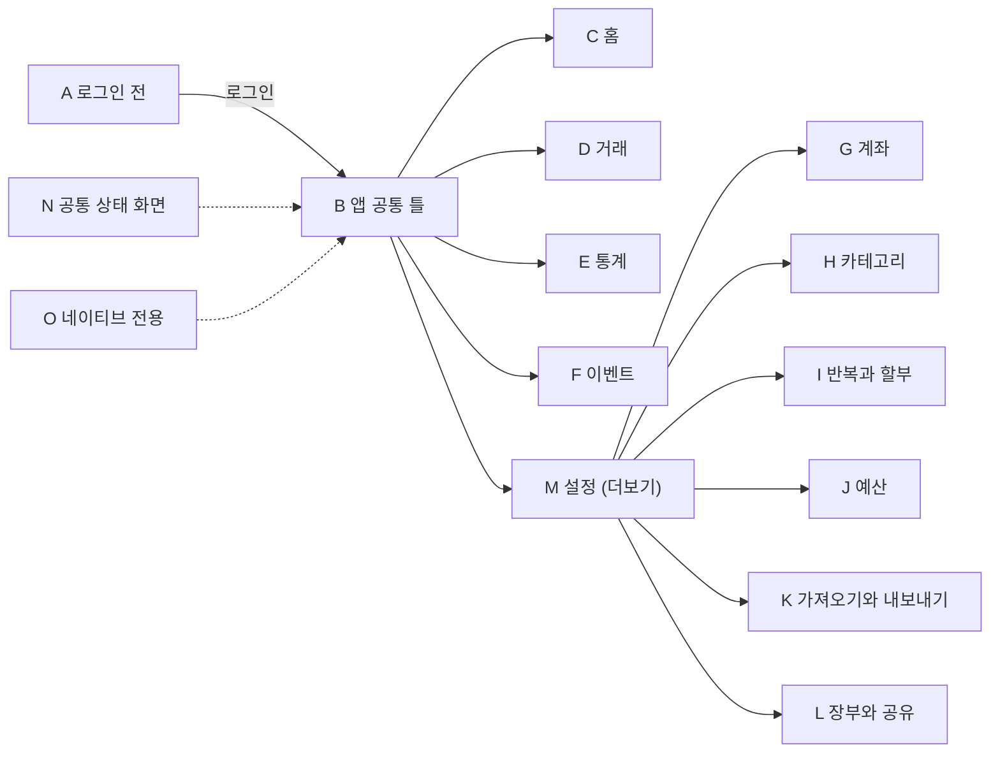

# 가계부 앱 정보구조도(IA)

- 작성일: 2026-11-18
- 상태: 초안, 2026-11-18 사용자 결정 반영, 2026-11-18 와이어프레임 빈틈 결정 반영(설계자 결정, 사용자 확인 전. 기능정의서의 `[설계자]` 표시와 같다), 2026-11-23 사용자 결정 반영(공개 시점, 호스팅, 출시 준비 순서, 문자 원문, 로그인 유지, 인증 방식), 2026-11-24 사용자 결정 반영(승인취소 문자, 변경 이력 삭제, 백업 보관, 서버 위치와 첫 배포)
- 근거 문서: [설계 문서](../superpowers/specs/2026-11-18-account-book-design.md), [프로젝트 개요서](01-project-overview.md), [페르소나와 사용 케이스](01a-personas.md)
- 표기:
  - 화면 ID는 그룹 문자와 두 자리 번호이다. 예: `A-01`
  - 화면 이름 뒤의 `[1]` `[2]` `[3]` `[4]` `[출시]` 는 그 화면이 들어가는 단계이다. 1은 혼자 쓰는 가계부, 2는 이벤트와 공유, 3은 입력 줄이기, 4는 네이티브 앱, 출시는 출시 준비이다.
  - 1단계 `[1]`은 세 조각(1A, 1B, 1C)으로 나눠 만든다. 조각별 기능과 규칙은 [1단계 조각](03a-phase1-slices.md)에 있다. 화면의 `[1]` 표시는 그대로 둔다. `[사용자]`(2026-11-23)
  - 출시 준비 항목 가운데 비밀번호 재설정(A-05, A-06, 메일 발송 포함), 약관과 개인정보 처리방침 동의와 화면(A-03의 약관 동의, A-08, A-09), 회원 탈퇴(M-05)는 2단계를 시작하기 전에 한다. 2단계부터 다른 사람의 데이터가 서버에 들어오기 때문이다. 이 화면들의 `[출시]` 표시는 그대로 둔다. 개인정보 처리방침의 내용은 여전히 미결이다(A-09). `[사용자]`(2026-11-23)
  - 한 화면 안의 일부 요소만 뒤 단계이면 그 요소 뒤에 단계를 붙인다.
  - `[미결]` 은 사용자 결정이 필요한 사항이다. 무엇이 미결인지 함께 적는다.
  - `[사용자]` 는 사용자가 직접 정한 것, `[제안]` 은 설계자가 정했고 사용자 확인 전인 것이다. 다른 기획 문서와 같은 표시이다.
  - 화면이 아니라 화면 안의 요소나 동작은 번호 없이 화면 설명에 적는다.

## 1. 한눈에 보는 구조

로그인 전 화면(A)과 로그인 후 화면을 나누고, 로그인 후에는 앱 공통 틀(B)이 모든 화면을 감싼다. 주 내비게이션은 홈, 내역, 통계, 이벤트, 더보기이고, 나머지 화면은 대부분 더보기(M)에서 들어간다.

## 2. 화면 트리

### A. 로그인 전

- A-01 소개 페이지 `[출시]`: 로그인 전에는 소개 페이지, 로그인, 가입, 약관, 개인정보 처리방침, 초대 링크 화면만 보이고 가계부 내용은 로그인해야 보인다. 예외는 열람 전용 화면(A-10)이다. `[사용자]`
- A-02 로그인 `[1]`: 가입(A-03)으로 가는 링크와 비밀번호 재설정 요청(A-05)으로 가는 링크 `[출시]` 가 있다. 회원 탈퇴를 신청하고 넘어오면 "탈퇴를 신청했다. 12월 18일까지 로그인하면 취소된다"처럼 영구 삭제 예정일을 넣은 알림을 보여 준다 `[출시]`.
- A-03 가입 `[1]`: 이메일, 비밀번호, 표시 이름, 약관 동의 `[출시]` 를 입력한다. 1단계에는 가입이 닫혀 있고 허용된 이메일만 가입한다. 로그인(A-02)으로 가는 링크가 있다.
  - A-04 이메일 인증 안내·완료 `[출시]`: 인증 안내에는 로그인(A-02)과 다른 이메일로 가입(A-03)으로 가는 링크가 있다.
- A-05 비밀번호 재설정 요청 `[출시]`
  - A-06 새 비밀번호 설정 `[출시]`
- A-07 초대 링크 착지 화면 `[2]`: 로그인 전에는 장부 이름과 초대한 사람을 보여주고 로그인·가입으로 안내한다. 로그인 후에는 수락 또는 거절을 고른다.
- A-08 이용약관 `[출시]`
- A-09 개인정보 처리방침 `[출시]` `[미결]` 처리방침 내용이 정해지지 않았다.
- A-10 열람 전용 화면 `[2]`: 열람 링크로 들어온 비로그인 사람이 보는 읽기 전용 장부 화면이다. 내역, 월 합계, 카테고리별 합계, 이벤트를 보여준다. 계좌 잔액은 발급할 때 "계좌 잔액 보이기"를 켠 경우에만 보이고, 구성원은 표시 이름만 보이며, 메모는 보이지 않는다. 만료되거나 폐기된 링크로 들어오면 그 사실만 알려준다.

### B. 앱 공통 틀

화면이 아니라 모든 화면에 걸친 틀이다. ID는 요소별로 매긴다.

- B-01 주 내비게이션 `[1]`: 홈, 내역, 통계, 이벤트 `[2]`, 더보기. 휴대폰 폭에서는 하단 탭, 넓은 화면에서는 왼쪽 사이드바이다.
- B-02 장부 전환기 `[2]`: 현재 장부를 고른다. "내 전체 지출", 장부 만들기, 코드로 참여(L-08)로 이동한다.
- B-03 빠른 입력 버튼 `[1]`: 거래 입력을 연다. 휴대폰 폭의 떠 있는 버튼은 아래에서 올라오는 전체 화면 입력, A 그룹, C-02, M 그룹, N 그룹에서는 보이지 않고, 그 밖의 모든 화면에 보인다. 넓은 화면에서는 사이드바의 "거래 입력" 버튼이며 사이드바가 보이는 모든 화면(M, N 그룹 포함)에 보인다. 어느 쪽이든 보기 전용 구성원에게는 보이지 않는다.
- B-04 동기화 상태 표시 `[1]`: 보내지 않은 입력이 있으면 "보내지 않은 입력 N건"을 상단 바(넓은 화면은 사이드바)에 늘 보여준다. 마지막으로 서버와 맞춘 시각은 B-05, 더보기 메뉴 맨 아래, 넓은 화면 사이드바 맨 아래에 보인다.
- 연결 없음 띠: 화면 ID가 없는 공통 틀 요소다. 연결이 없을 때 모든 화면의 상단 바 바로 아래(넓은 화면은 내용 영역 맨 위)에 한 줄로 보인다(N-03).
  - B-05 보내지 않은 입력 목록 `[1]`: 다시 보내기, 버리기. 서버가 거부한 입력(계좌나 카테고리가 삭제됨, 장부에서 내보내짐)은 "보낼 수 없음"과 이유를 표시하고, 고쳐서 다시 보내거나 버린다.
- B-06 미확인 건수 배지 `[3]`

### C. 홈

- C-01 홈 `[1]`: 이번 달 수입·지출 합계, 계좌 잔액 요약, 최근 거래, 한 줄 입력창을 둔다. 진행 중 이벤트 `[2]`, 예산 진행 `[3]`, 미확인 건수 `[3]` 도 보인다.
- C-02 첫 실행 안내 `[1]`: 기본 카테고리를 확인하고 첫 계좌를 만든다. 계좌가 하나도 없을 때만 나온다. 건너뛰면 "현금" 계좌를 자동으로 만든다. 안내를 마치는 자리에서 장부 소유자에게 "사람 초대하기"(L-06)와 "나중에"를 보여 준다 `[2]`.

### D. 거래

- D-01 내역 `[1]`: 월 이동과 필터를 쓴다. 필터는 계좌, 카테고리, 유형, 상태, 결제한 사람 `[2]`, 이벤트 `[2]` 이다. 넓은 화면에는 일괄 수정(D-10)으로 가는 "여러 건 고르기" `[3]` 가 있다.
- D-02 달력 `[1]`: 날짜별 합계를 보여준다. 날짜를 누르면 그날 거래를 보여준다. 필터가 없고 내역의 필터도 이어지지 않는다.
- D-03 검색 `[1]`
- D-04 거래 입력·수정 `[1]`: 지출, 수입, 이체를 입력한다. 지출에는 "돌려받음" 선택 항목이 있다. 분할 입력 `[3]`, 할부 `[3]`, 반복으로 만들기 `[3]` 가 있다.
- D-05 한 줄 입력 결과 확인 `[1]`: "점심 12000" 을 해석한 결과를 보여주고 저장하거나 고친다.
- D-06 거래 상세 `[1]`: 수정, 승인취소와 되돌리기, 삭제가 있다. 이벤트 소속 바꾸기(자동, 포함, 제외) `[2]`, 환불 연결 `[3]`, 미확인 거래의 확인 `[3]` 도 여기서 한다. 휴지통(D-08)에서 열면 읽기 전용이며 복원, 완전히 지우기, 변경 이력만 있다.
  - D-07 변경 이력 `[1]`: 위쪽에 어느 거래인지 요약(날짜, 가맹점/내용, 금액)을 둔다.
- D-08 휴지통 `[1]`: 삭제한 거래 목록을 보여주고 복원한다. 완전히 지우기도 여기서 하며 확인을 한 번 받는다. 줄을 누르면 거래 상세(D-06)를 읽기 전용으로 연다.
- D-09 미확인 검토 목록 `[3]`: 확인, 고치기, 계좌 지정, 합치기 제안 수락·거절, 삭제를 한다.
- D-10 일괄 수정 `[3]`: 넓은 화면 전용이다. 넓은 화면 내역(D-01)의 "여러 건 고르기"로 들어온다. 휴대폰 폭에서 주소로 열면 "넓은 화면에서만 쓸 수 있다"와 "내역으로 가기"만 보인다.

### E. 통계

여섯 화면 모두 맨 위에 전환 줄을 둔다. 월 통계(E-01, E-02, E-03 `[2]`, E-04 `[3]`)와 연 통계(E-05, E-06 `[2]`)로 나눈다. 월 통계 사이를 옮길 때는 고른 달이 유지되고, 연 통계로 가면 그 달이 속한 연도가 선택되며, 월 통계로 돌아오면 이전에 고른 달로 돌아온다.

- E-01 월별 통계 `[1]`: 지출이 큰 카테고리를 가로 막대로 보여준다.
- E-02 카테고리별 통계 `[1]`: 카테고리별 가로 막대를 둔다. 카테고리를 누르면 해당 거래 목록을 보여준다. 이벤트 지출 제외 보기 `[2]` 가 있다.
- E-03 결제한 사람별 합계 `[2]`: 사람을 누르면 그 달, 그 사람의 결제한 사람 필터를 켠 내역(D-01)이 열린다.
- E-04 예산 대비 `[3]`: 예산이 있으면 "예산 고치기"(J-01)로 간다.
- E-05 연 단위 통계 `[1]`: 월별 통계와 같은 구성으로 1월부터 12월까지의 월별 추이(세로 막대)와 연 합계를 보여준다.
- E-06 회비 현황 `[2]`: 회비로 볼 수입 카테고리를 하나 지정하면 월별로 구성원별 입금 여부와 금액을 표로 보여준다. 가입한 구성원만 표에 나온다.

### F. 이벤트

그룹 전체가 `[2]` 이다.

- F-01 이벤트 목록 `[2]`: 진행 중, 예정, 지난 것으로 나눈다. 반복 이벤트를 겹쳐서 만들지 못했다는 알림 `[3]` 도 여기에 보인다.
- F-02 이벤트 만들기·수정 `[2]`: 이름과 시작·종료 일시를 정한다. 같은 장부의 다른 이벤트와 기간이 겹치면 저장할 수 없다. 반복 규칙 설정 `[3]` 도 여기서 한다.
- F-03 이벤트 상세 `[2]`: 합계, 하루 평균, 카테고리별 합계, 묶인 거래, 제외한 거래를 보여준다. 거래 포함·제외, 이벤트 복제, 이벤트 삭제, 반복 중지 `[3]` 도 여기서 한다.

### G. 계좌

- G-01 계좌 목록 `[1]`: 은행, 카드, 현금별 잔액을 보여준다. 숨긴 계좌는 목록 아래 "숨긴 계좌"에 따로 모이고 그 묶음의 합계를 따로 보여준다. 종류별 합계에는 숨긴 계좌를 넣지 않고 자산 합계에는 넣는다.
- G-02 계좌 추가·수정 `[1]`: 이름, 종류, 시작 잔액과 기준일, 카드 식별 문구 `[3]` 를 입력한다.
- G-03 계좌 상세 `[1]`: 잔액과 그 계좌의 거래를 보여주고 계좌를 삭제한다. 거래 줄은 내역(D-01)과 같은 구성이고 누르면 거래 상세(D-06)로 간다. 거래가 있는 계좌는 삭제 대신 숨기기(보관)를 하고, 숨긴 계좌는 다시 보이게 할 수 있다.

### H. 카테고리

- H-01 카테고리 관리 `[1]`: 수입·지출 구분, 2단계 구조, 추가, 이름 바꾸기, 삭제를 한다.

### I. 반복과 할부

그룹 전체가 `[3]` 이다. I-01과 I-03 위에 "반복 거래 | 할부" 전환 줄을 둔다.

- I-01 반복 거래 목록 `[3]`: 중지, 다시 시작, 삭제를 한다.
- I-02 반복 거래 추가·수정 `[3]`
- I-03 할부 목록 `[3]`: 진행 중인 할부와 남은 회차, 남은 금액을 보여준다. 둘 다 이번 달 청구분을 포함한다.

### J. 예산

그룹 전체가 `[3]` 이다.

- J-01 월 예산 설정 `[3]`: 전체와 카테고리별 예산을 정하고 수정, 삭제한다. 지출의 미분류에도 예산을 정할 수 있다.

### K. 가져오기와 내보내기

- K-01 엑셀·CSV 내보내기 `[1]`
- K-02 엑셀 가져오기, 파일 선택 `[3]`: 카드사 엑셀뿐 아니라 일반 엑셀도 가져온다.
- K-03 엑셀 가져오기, 미리보기와 열 맞추기 `[3]`: 카드사 양식은 미리 정해 둔 열 맞춤을 쓰고, 그 밖의 엑셀은 사용자가 열을 직접 맞춘다.
- K-04 엑셀 가져오기, 결과 `[3]`: 들어온 건수와 건너뛴 건수를 보여주고 미확인 검토 목록(D-09)으로 이동한다.
- K-05 가져오기 기록 `[3]`: 지난 가져오기를 보여주고, 가져오기 한 번을 통째로 되돌린다.

K-02, K-03, K-04는 파일 선택, 미리보기와 열 맞추기, 결과 순으로 이어지는 세 단계이다. K-01, K-02, K-05 위에 "내보내기 | 가져오기 | 가져오기 기록" 전환 줄을 둔다(가져오기와 기록은 `[3]` 이므로 1·2단계에는 전환 줄이 없고, 보기 전용 구성원에게는 두 칸이 보이지 않아 전환 줄이 없다). 더보기와 사이드바의 항목 이름은 1·2단계에 "내보내기", 3단계부터 "가져오기·내보내기"이며 K-01로 간다. 카드사 양식을 고르면 K-03에 미리 정한 열 맞춤이 채워지고 사용자가 고칠 수 있다.

### L. 장부와 공유

그룹 전체가 `[2]` 이다.

구성원 권한은 소유자(OWNER), 편집 가능(MEMBER), 보기 전용(VIEWER) 세 가지이다. 보기 전용은 조회와 내보내기만 한다. 구성원 관리, 초대, 열람 링크, 장부 이름 바꾸기, 장부 삭제, 소유권 넘기기는 소유자만 한다. 보기 전용 권한을 두는 것은 `[사용자]`, 권한별 범위는 `[제안]` 이다.

- L-01 장부 목록 `[2]`: 소유자는 이 목록의 "삭제한 장부"에서 삭제한 지 30일 안의 장부를 복구한다. 장부 만들기(L-02)와 코드로 참여(L-08)로 가는 버튼이 있다.
- L-02 장부 만들기 `[2]`
- L-03 내 전체 지출 `[2]`: 내가 속한 모든 장부에서 내가 결제한 거래의 합계를 보여준다. 거래 줄은 내역(D-01)과 같은 구성에 장부 이름을 더하고, 누르면 거래 상세(D-06)로 간다. 다른 장부의 거래를 누르면 현재 장부가 그 장부로 바뀌고 장부 전환기에 바뀐 이름이 보인다.
- L-04 장부 설정 `[2]`: 이름 바꾸기, 장부 나가기, 장부 삭제. 이름 바꾸기와 삭제는 소유자만 할 수 있다. 나가기 확인에 엑셀 내보내기 버튼이 있으며, 누르면 K-01을 열지 않고 그 장부의 전체 기간 엑셀 파일을 바로 내려받는다. 삭제한 장부는 30일 안에 복구할 수 있다.
  - L-05 구성원 목록 `[2]`: 구성원 내보내기, 권한 바꾸기(편집 가능, 보기 전용), 소유권 넘기기는 소유자만 할 수 있다.
  - L-06 초대 만들기 `[2]`: 링크 또는 코드를 만들고 만료 시각을 정한다. 권한을 고르고, "이 장부의 모든 내역이 상대에게 보인다"는 안내를 보여준다. 만든 뒤에는 링크, 코드와 함께 권한과 만료 일시를 보여준다.
  - L-07 대기 중인 초대 목록 `[2]`: 초대를 취소한다. 링크와 코드를 다시 복사할 수 있다.
  - L-09 열람 링크 관리 `[2]`: 소유자만 쓴다. 열람 링크를 발급하고 폐기한다. 만료와 계좌 잔액 표시 여부를 정하고, "링크를 가진 사람은 누구나 볼 수 있다"는 경고를 보여준다.
- L-08 코드로 참여 `[2]`: 장부 전환기(B-02)와 장부 목록(L-01)의 "코드로 참여"로 들어온다.

### M. 설정

더보기 탭 아래에 둔다.

- M-01 더보기 메뉴 `[1]`: G, H, I, J, K, L 그룹, 휴지통(D-08), 설정으로 가는 목록이다. K 그룹으로 가는 항목은 하나이며 이름이 1·2단계에는 "내보내기", 3단계부터 "가져오기·내보내기"이다(K-01로 간다). 넓은 화면에는 이 화면이 없고 사이드바에 같은 항목이 있다. 사이드바의 "설정"은 프로필(M-02)로 가며, 넓은 화면의 설정 화면은 왼쪽에 설정 목록(프로필, 화면 설정, 문자 자동 입력 `[3]`, 이용약관, 개인정보 처리방침, 회원 탈퇴 `[출시]`, 앱 잠금 `[4]`)을 두고 오른쪽에 고른 항목을 보여준다.
- M-02 프로필 `[1]`: 표시 이름, 비밀번호 바꾸기, 로그아웃, 모든 기기에서 로그아웃 `[출시]`.
- M-03 화면 설정 `[1]`: 테마를 시스템 따름, 밝게, 어둡게 중에서 고른다.
- M-04 문자 자동 입력 설정 `[3]`: 전송 주소 발급, 다시 발급, 끄기, 받을 장부 지정, 단축어 설정 안내.
- M-05 회원 탈퇴 `[출시]`: 30일 유예 뒤 영구 삭제하고 유예 중 로그인하면 취소된다. 혼자 쓰던 장부는 함께 지우고 공유 장부에 적은 거래는 작성자를 "탈퇴한 사용자"로 바꿔 남기며, 소유자는 소유권을 넘기거나 장부를 삭제해야 탈퇴할 수 있다. `[사용자]` 신청 확인 창에 영구 삭제 예정일을 보여 주고, 신청이 끝나면 로그아웃하고 로그인(A-02)으로 간다. 완료 화면은 따로 없다.
- M-06 앱 잠금 설정 `[4]`: Face ID를 쓰며 네이티브 전용이다.

### N. 공통 상태 화면

- N-01 찾을 수 없음 `[1]`
- N-02 접근 권한 없음 `[2]`: 내보내졌거나 나간 장부, 삭제된 장부를 열려고 할 때와 권한이 모자란 동작을 할 때 보인다. 장부를 볼 수 없는 경우의 버튼은 "다른 장부로 가기", 권한이 모자란 동작인 경우의 버튼은 "돌아가기"(이전 화면) 하나다.
- N-03 서버 오류·연결 없음 안내 `[1]`
- N-04 수정 충돌 안내 `[1]`: 다른 기기에서 먼저 고친 거래를 저장하려 할 때 보인다. 최신 내용 보기 또는 내 입력 다시 적용을 고른다.

### O. 네이티브 전용

그룹 전체가 `[4]` 이다.

- O-01 홈 화면 위젯 `[4]`

화면 ID는 모두 70개이다. 2026-11-18 결정으로 A-10, C-02, E-05, E-06, K-05, L-09의 6개가 늘었다.

| 그룹 | 개수 |
|------|------|
| A 로그인 전 | 10 |
| B 앱 공통 틀 | 6 |
| C 홈 | 2 |
| D 거래 | 10 |
| E 통계 | 6 |
| F 이벤트 | 3 |
| G 계좌 | 3 |
| H 카테고리 | 1 |
| I 반복과 할부 | 3 |
| J 예산 | 1 |
| K 가져오기와 내보내기 | 5 |
| L 장부와 공유 | 9 |
| M 설정 | 6 |
| N 공통 상태 화면 | 4 |
| O 네이티브 전용 | 1 |

## 3. 내비게이션

- 주 내비게이션(B-01)은 홈(C-01), 내역(D-01), 통계(E-01), 이벤트(F-01) `[2]`, 더보기(M-01)로 구성된다.
- 휴대폰 폭에서는 하단 탭, 넓은 화면에서는 왼쪽 사이드바로 보인다.
- 장부 전환기(B-02) `[2]` 에서 현재 장부를 고르고, "내 전체 지출"(L-03), 장부 만들기(L-02), 코드로 참여(L-08)로 이동한다. 장부 목록(L-01)에서도 장부 만들기와 코드로 참여로 간다.
- 빠른 입력 버튼(B-03)은 거래 입력(D-04)을 연다. 보이는 화면의 범위는 2절 B-03을 따른다.
- 동기화 상태 표시(B-04)는 보내지 않은 입력이 있을 때 "보내지 않은 입력 N건"을 보여주고, 누르면 보내지 않은 입력 목록(B-05)으로 간다. 마지막으로 서버와 맞춘 시각은 B-05, 더보기 메뉴 맨 아래, 넓은 화면 사이드바 맨 아래에 있다.
- 미확인 건수 배지(B-06) `[3]` 는 미확인 검토 목록(D-09)과 연결된다.
- 더보기(M-01)에서 계좌(G), 카테고리(H), 반복과 할부(I), 예산(J), 가져오기와 내보내기(K), 장부와 공유(L), 휴지통(D-08), 설정(M-02, M-03, M-04, M-05, M-06), 이용약관(A-08), 개인정보 처리방침(A-09)으로 간다.
- 넓은 화면 사이드바에서는 "반복과 할부"가 반복 거래 목록(I-01)으로, "가져오기·내보내기"(1·2단계 이름은 "내보내기")가 내보내기(K-01)로, "설정"이 프로필(M-02)로 간다. I-01과 I-03은 화면 위의 전환 줄로 오가고, K-01, K-02, K-05도 전환 줄로 오간다 `[3]`(보기 전용 구성원에게는 전환 줄이 없다). 설정 화면들(M-02~M-05)과 약관은 넓은 화면에서 왼쪽 설정 목록으로 오간다.
- 가져오기 기록(K-05) `[3]` 은 더보기 아래 가져오기와 내보내기(K)에서, 열람 링크 관리(L-09) `[2]` 는 더보기 아래 장부와 공유(L)의 장부 설정(L-04)에서 들어간다.
- 통계는 통계(E-01)에서 들어가고, 화면 위의 전환 줄로 월별(E-01), 카테고리별(E-02), 결제한 사람별(E-03) `[2]`, 예산 대비(E-04) `[3]`, 연 단위(E-05), 회비 현황(E-06) `[2]` 사이를 오간다. 결제한 사람별 합계(E-03)에서 사람을 누르면 그 사람의 결제한 사람 필터를 켠 내역(D-01)으로 간다. 예산 대비(E-04)의 "예산 고치기"는 월 예산 설정(J-01)으로 간다. 연 단위 통계(E-05)의 카테고리 줄을 누르면 그 카테고리 필터와 그해 1월 1일~12월 31일 기간을 채운 검색(D-03)으로 간다. `[설계자]`(2026-11-20)
- 일괄 수정(D-10) `[3]` 은 넓은 화면 내역(D-01)의 "여러 건 고르기"로 들어간다. 휴지통(D-08)의 줄을 누르면 거래 상세(D-06)가 읽기 전용으로 열린다.
- 가입 직후 처음 들어오면 첫 실행 안내(C-02)가 나온다. 계좌가 하나도 없을 때만 나온다. `[2]` 부터는 안내를 마치는 자리에서 장부 소유자에게 초대 만들기(L-06)로 가는 "사람 초대하기"와 "나중에"(홈)를 보여준다.
- 로그인(A-02)에서 가입(A-03)과 비밀번호 재설정 요청(A-05) `[출시]` 으로, 가입(A-03)에서 로그인(A-02)으로 간다. 이메일 인증 안내(A-04)에서는 로그인(A-02)과 가입(A-03)으로 간다. 회원 탈퇴(M-05)를 신청하면 로그아웃하고 로그인(A-02)으로 간다.
- 접근 권한 없음(N-02)에서 장부를 볼 수 없는 경우에는 "다른 장부로 가기"로 다른 장부로, 권한이 모자란 동작인 경우에는 "돌아가기"로 이전 화면으로 간다.
- 열람 링크를 받은 사람은 링크 주소로 열람 전용 화면(A-10)에 바로 들어온다. 로그인 화면을 거치지 않는다.
- 로그인하지 않은 채 로그인이 필요한 주소로 들어오면 로그인(A-02)으로 보내고, 로그인 뒤 원래 가려던 화면으로 돌아간다.

## 4. 반대편 화면 점검

| 행위 | 반대 행위 | 위치(화면 ID) | 상태 |
|------|-----------|---------------|------|
| 가입 | 회원 탈퇴 | A-03 / M-05 | 있음 |
| 탈퇴 신청 | 유예 중 로그인으로 취소 | M-05 / A-02 | 있음. 30일 유예가 지나면 되돌릴 수 없다 |
| 로그인 | 로그아웃 | A-02 / M-02 | 있음 |
| 거래 만들기 | 삭제, 복원 | D-04 / D-06 / D-08 | 있음. 휴지통에는 30일 동안 있다(5절 1번) |
| 휴지통 완전히 지우기 | 없음 | D-08, D-06(휴지통에서 연 상세) | 되돌릴 수 없다. 확인을 한 번 받는다(5절 1번) |
| 승인취소 | 되돌리기 | D-06 | 있음 |
| 계좌 추가 | 삭제 | G-02 / G-03 | 있음. 거래가 있는 계좌는 삭제하지 않고 숨긴다(5절 2번) |
| 계좌 숨기기 | 다시 보이기 | G-03 | 있음 |
| 카테고리 추가 | 삭제 | H-01 | 있음. 삭제할 때 거래를 옮길 카테고리를 고른다(5절 3번) |
| 장부 만들기 | 장부 삭제 | L-02 / L-04 | 있음 |
| 장부 삭제 | 복구 | L-04 / L-01 | 있음. 30일 안에 소유자가 복구한다(5절 10번) |
| 초대 만들기 | 초대 취소 | L-06 / L-07 | 있음 |
| 초대 수락 | 장부 나가기, 내보내기 | A-07 / L-04 / L-05 | 있음. 소유자는 소유권을 넘긴 뒤에만 나갈 수 있다(5절 4번) |
| 소유권 넘기기 | 새 소유자가 다시 넘김 | L-05 | 있음. 되돌리는 별도 기능은 없다(5절 4번) |
| 권한 바꾸기 | 권한 다시 바꾸기 | L-05 | 있음 |
| 열람 링크 발급 | 폐기 | L-09 | 있음. 만료도 있다 |
| 이벤트 만들기 | 삭제 | F-02 / F-03 | 있음. 삭제하면 묶였던 거래는 자동 상태로 돌아간다(5절 13번) |
| 이벤트 반복 설정 | 반복 중지 | F-02 / F-03 | 있음 `[3]`. 중지해도 이미 만든 이벤트는 남는다 |
| 이벤트에 포함 | 제외, 자동으로 되돌리기 | D-06 / F-03 | 있음 |
| 엑셀 가져오기 | 가져오기 되돌리기 | K-02, K-03, K-04 / K-05 | 있음. 가져온 뒤 고쳤거나 확인한 거래는 남긴다(5절 5번) |
| 합치기 | 다시 나누기 | D-09 | 두지 않음, 정책으로 명시(5절 6번) |
| 미확인 확인 | 미확인으로 되돌리기 | D-09 | 두지 않음, 정책으로 명시(5절 15번) |
| 환불 연결 | 연결 해제 | D-06 | 거래 상세에 있음 |
| 반복 거래 시작 | 중지, 다시 시작 | I-01 / I-02 | 있음 |
| 예산 설정 | 삭제 | J-01 | 있음 |
| 문자 전송 주소 발급 | 끄기, 다시 발급 | M-04 | 있음 |
| 오프라인 입력 쌓기 | 다시 보내기, 버리기 | B-04 / B-05 | 있음 |
| 앱 잠금 켜기 | 끄기 | M-06 | 있음 |

5절의 7번(이메일 주소 바꾸기), 8번(기기 목록과 기기별 로그아웃), 9번, 11번, 12번, 14번은 위 표의 쌍에 속하지 않고 트리를 살피며 찾은 빈틈이다.

## 5. 기능정의서로 넘긴 빈틈과 결정

아래 결정은 모두 설계자가 정했고 사용자 확인 전이다. `[제안]` 세부 규칙은 [기능정의서](03-feature-spec.md)의 정책(P-ID)으로 넘겼다.

| 번호 | 빈틈 | 결정 |
|------|------|------|
| 1 | 휴지통에서 완전히 지우기, 휴지통 보관 기간 | 삭제한 거래는 휴지통(D-08)에 30일 동안 있다가 자동으로 영구 삭제된다. 휴지통에서 직접 완전히 지울 수 있고 확인을 한 번 받는다. 복원하면 삭제 전 상태로 돌아간다. 거래를 완전히 지우면 변경 이력에는 "누가 언제 지웠다"만 남고 내용 값은 지운다(P-215). `[사용자]`(2026-11-24) |
| 2 | 거래가 있는 계좌의 삭제 | 거래가 없는 계좌만 삭제한다. 거래가 있는 계좌는 숨기기만 되며, 숨긴 계좌는 입력 선택 목록에서 빠지고 과거 내역, 통계, 자산 합계에는 그대로 들어간다(G-01, G-03). |
| 3 | 카테고리 삭제 때 거래 처리, 상위 카테고리 삭제 | 거래를 옮길 카테고리를 고른다(기본값 미분류). 상위를 삭제하면 하위도 함께 삭제되고 거래는 모두 고른 곳으로 옮긴다. 미분류는 삭제와 이름 바꾸기를 할 수 없다(H-01). |
| 4 | 소유자가 장부를 나갈 때, 소유권 넘기기 | 소유자는 편집 가능 구성원 한 명에게 소유권을 넘기고 이전 소유자는 편집 가능이 된다. 소유자는 넘긴 뒤에만 나갈 수 있고, 혼자 남은 장부는 나갈 수 없고 삭제만 된다(L-05, L-04). |
| 5 | 엑셀 가져오기 한 번을 통째로 되돌리기 | 가져오기 기록(K-05)에서 되돌린다. 가져온 뒤 고쳤거나 확인한 거래는 남기고 몇 건이 남았는지 알려주며, 되돌린 거래는 휴지통으로 간다. |
| 6 | 합친 거래를 다시 나누기 | 두지 않는다. 해당 없음으로 명시한다. 합치기는 변경 이력에 남는다. |
| 7 | 이메일 주소 바꾸기 | 출시 범위에 없다. 해당 없음으로 명시한다. |
| 8 | 로그인된 기기 목록과 기기별 로그아웃 | "모든 기기에서 로그아웃"(M-02) `[출시]` 만 둔다. 기기 목록과 기기별 로그아웃은 출시 후로 미루고 지금은 해당 없음으로 명시한다. |
| 9 | 내보내진 구성원이 장부를 열어 둔 상태, 남은 보내지 않은 입력 | 내보내진 뒤 그 장부에 대한 다음 요청에서 N-02를 보여주고 다른 장부로 옮긴다. 그 장부에 보내지 않은 입력은 B-05에서 "보낼 수 없음"으로 표시한다. |
| 10 | 삭제한 장부의 복구 | 소유자만 장부 이름을 입력해 삭제한다. 삭제하면 모든 구성원에게 바로 보이지 않고, 30일 안에는 소유자가 L-01의 "삭제한 장부"에서 복구하며 30일 뒤 영구 삭제된다. 영구 삭제할 때 그 장부 거래의 변경 이력도 같이 지운다(P-308). `[사용자]`(2026-11-24) |
| 11 | 초대 하나로 들어올 수 있는 인원 | 초대 하나로 만료 전까지 여러 명이 들어올 수 있고, 장부 하나의 구성원은 최대 20명이다. 초대는 소유자만 만들며 권한과 만료(1일, 7일, 30일, 기본 7일)를 고르고 언제든 취소할 수 있다. |
| 12 | 가입 때 생긴 개인 장부와 마지막 장부의 삭제·나가기 | 사용자는 항상 장부 1개 이상에 속하므로 마지막 남은 장부는 삭제하거나 나갈 수 없다. 가입 때 생긴 개인 장부도 다른 장부와 똑같이 다룬다. 이 규칙은 탈퇴에는 적용하지 않는다. |
| 13 | 이벤트 삭제와 기간 변경 때 수동 포함·제외 거래 | 삭제하면 묶였던 거래는 모두 소속이 풀리고 자동 상태로 돌아가며 거래 자체는 지워지지 않는다. 기간을 바꾸면 자동 상태인 거래만 다시 판정하고, 직접 포함하거나 제외한 거래는 그대로 둔다. |
| 14 | 오프라인 입력을 서버가 거부할 때 | 자동으로 버리지 않는다. B-05에 "보낼 수 없음"과 이유를 표시하고 사용자가 고쳐서 다시 보내거나 버린다. |
| 15 | 확인한 거래를 미확인으로 되돌리기 | 두지 않는다. 해당 없음으로 명시한다. |

페르소나 사용 케이스에서 나온 빈틈 G-16~G-28은 미결인 G-25(간편 로그인)를 빼고 모두 결정해 이 트리에 반영했다. 결정 내용은 [페르소나와 사용 케이스](01a-personas.md) 3절에 있다.

## 6. 체크리스트 결과

| 항목 | 판정 | 근거 |
|------|------|------|
| 모든 화면·메뉴가 트리에 있는가 | 통과 | 설계 문서 8장의 1~4단계와 출시 준비 항목을 모두 화면에 대응시켰다. 2026-11-18 결정으로 생긴 화면 6개도 넣었다. |
| 한눈에 구조를 파악할 수 있는가 | 통과 | 1절의 그림과 2절의 트리. |
| 반대편 화면 점검 | 통과 | 4절. 빈틈이던 쌍은 결정대로 고쳤고, 반대 행위를 두지 않는 것은 정책으로 명시했다. |
| 빈틈을 기능정의서에 넘겼는가 | 통과 | 5절의 빈틈과 G-16~G-28을 결정해 [기능정의서](03-feature-spec.md)의 정책으로 넘겼다. G-25(간편 로그인)는 미결로 남았다. |
